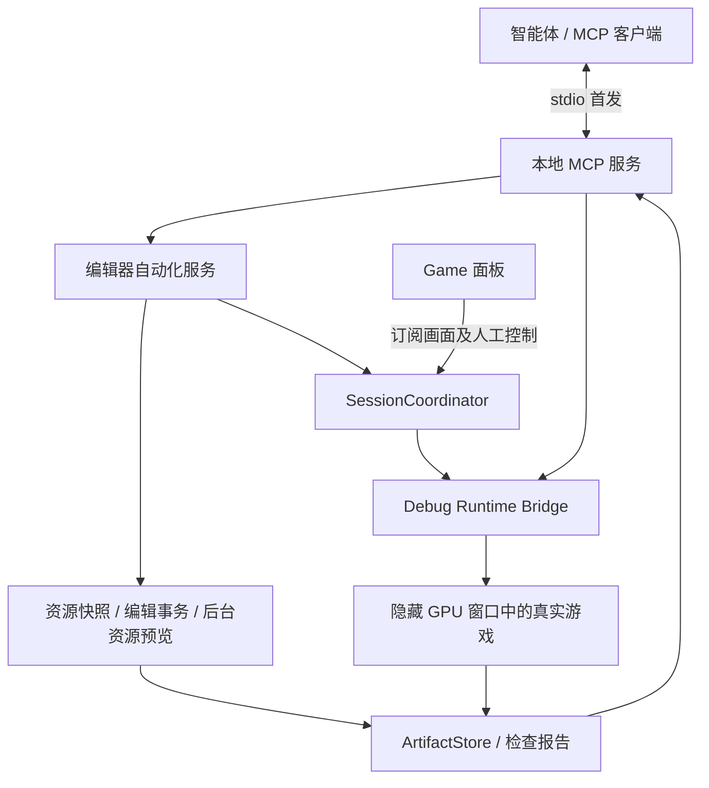

# Defold 后台自动化与 MCP 详细实施方案

状态：目标设计；Windows 后台操作首版已另行实现，完整方案尚未全部实施。日期：2026-10-26。

实施记录：Windows 后台操作首版现已另行实现，实际交付范围见 [scripts/automation/README.md](X:/AI/UI/defold/scripts/automation/README.md)。它采用本 fork 的原生桥接，不代表本方案的官方模块集成、同帧精确布局及全部 P1/P2 功能已经完成。下文保留目标设计与分期。

适用工程：`X:/AI/UI/defold`。首批验证平台：Windows 当前 OpenGL 渲染链路；macOS、其他图形后端分别验收。

本文定义目标接口和任务拆分。下文标注为“新增”“拟定”的模块、工具和字段属于规划，实际实现状态以独立的首版使用说明为准。

## 1. 目标与交付范围

让智能体在开发过程中完成以下闭环：

> 读取项目 → 后台预览或运行 → 定位元素 → 操作 → 等待明确结果 → 查验画面与布局 → 修改资源 → 再验证 → 交付原图、对比图及报告。

完成后的典型任务包括：

- 不打开资源页签，预览指定 GUI、Collection、GO，检查节点布局和层级。
- 后台运行游戏，点击按钮、拖动瞄准、滚动列表、输入文字，并验证操作结果。
- 对多个设备、横竖屏和安全区重复同一个测试流程。
- 修改 GUI 节点位置、尺寸、锚点、轴心和布局，保留编辑器撤销能力。
- 返回聊天中可以直接查看的图片，同时保留可追溯的原始文件和结构化报告。

第一版后台运行的定义：编辑器进程和 JavaFX toolkit 可以保持运行，Game 面板可以未打开或不可见，用户可操作其他程序；测试游戏使用隐藏的 GPU 窗口执行正常渲染。首版不要求无 GPU、无桌面会话或 `dmengine_headless` 输出画面。

默认新建智能体拥有的测试会话。接入用户正在玩的游戏是另一种明确的 `attached` 模式，避免测试随意重启或关闭用户的游戏。

## 2. 已有基础与真实缺口

| 领域 | 已有实现 | 复用方式与需要补充的内容 |
|---|---|---|
| 项目发现及 HTTP | `.internal/editor.port`、`.internal/editor.token`、OpenAPI | 增加稳定的自动化服务入口和能力协商 |
| 编译及热更新 | 编辑器命令服务已有 build/run/hot-reload | 复用构建逻辑，拆开“构建”“启动会话”“显示 Game” |
| 资源 PNG | `/preview/{path}` 已输出 PNG | 统一到设备、布局、相机明确的预览服务；原接口不等价于实际运行截图 |
| GUI 自适应 | `gui_preview/render-data` 使用 private graph basis 计算布局和安全区 | 去掉对当前 SceneView 的隐式依赖，改为显式 PreviewSpec |
| Game 画面 | Windows 隐藏游戏窗口、按需读回、共享内存双缓冲 | 抽出会话与帧服务，解除面板可见性、焦点、AnimationTimer 的依赖 |
| GUI 数据读取 | PhotoCraft snapshot 含 graph revision、disk hash、dirty 信息 | 提取通用资源快照服务，不要求打开页签 |
| GUI 编辑 | PhotoCraft 已有基线校验、图事务和 operation sequence | 复用底层操作；现有发布入口拒绝 dirty 资源，不能直接宣称支持编辑未保存内容 |
| 运行时检查 | 引擎已有 HTTP、场景遍历、GUI 属性和扩展入口 | 集成官方 Automation Bridge，再补精确布局与帧关联 |
| 自动化测试 | plorer、离屏输入探针、真实引擎回归 | plorer 用于编辑器自身 UI 验收，正式 MCP 业务走类型化服务 |

主要代码依据：

- [GamePreview.java](X:/AI/UI/defold/editor/src/java/com/defold/editor/GamePreview.java:294)：会话当前绑定项目面板，隐藏或失焦会影响输入和捕帧。
- [game_preview.clj](X:/AI/UI/defold/editor/src/clj/editor/game_preview.clj:45)：编辑预览当前依赖 active view。
- [gui_preview.clj](X:/AI/UI/defold/editor/src/clj/editor/gui_preview.clj:123)：GUI 布局、安全区和 private basis 计算。
- [scene.clj](X:/AI/UI/defold/editor/src/clj/editor/scene.clj:597)：预览 FBO；[资源 PNG 接口](X:/AI/UI/defold/editor/src/clj/editor/scene.clj:2622)。
- [craft_project.clj](X:/AI/UI/defold/editor/src/clj/editor/craft_project.clj:113)、[craft_publish.clj](X:/AI/UI/defold/editor/src/clj/editor/craft_publish.clj:112)：资源快照与编辑事务。
- [engine.cpp](X:/AI/UI/defold/engine/engine/src/engine.cpp:2069)：扩展更新在输入绑定处理前；[PostRender/Flip 边界](X:/AI/UI/defold/engine/engine/src/engine.cpp:2204)。
- [comp_gui.cpp](X:/AI/UI/defold/engine/gamesys/src/gamesys/components/comp_gui.cpp:3793)：GUI 运行时属性遍历。
- [game-simulator.h](X:/AI/UI/defold/scripts/windows/game-simulator.h:145)：当前 Windows 捕帧路径。

`defold-robot` 依赖真实桌面输入、切换焦点和屏幕截图。可参考它的测试报告组织方式，不把它作为后台服务底座。

## 3. 采用的架构



### 3.1 引擎层

官方 Automation Bridge 提供运行时查询、输入和截图的基础协议。固定已验证的 tag/commit，保留来源与许可证；本地增加的帧、设备和布局能力独立版本化，不改变官方字段的原有含义。

拟将桥接集成为受控的 Debug 模块，随本地 debug engine 一起构建，使普通项目能够使用。包含 Spine 等 native extension 的项目必须参与同一次兼容构建，不能替换成缺失其扩展的普通引擎。

正式 Release 构建不包含自动化控制端点和调试 Lua 通道。

### 3.2 编辑器层

新增逻辑服务：

- `SessionCoordinator`：进程生命周期、会话身份、设备、控制权与退出清理。
- `ResourcePreviewService`：按资源路径和 PreviewSpec 渲染，不修改当前页签与选择。
- `FrameStore`：保存不可变的观测记录和帧数据，多观察者共享。
- `ResourceTransactionService`：读取 graph 快照、版本校验、批量编辑、保存、撤销。
- `ArtifactStore`：原图、标注、差异图、元数据及报告的生命周期。

Game 面板订阅会话画面；关闭面板只解除订阅，不结束仍由智能体拥有的后台会话。人工启动的游戏保留现有操作习惯。

### 3.3 MCP 层

采用独立本地服务，建议 Python 实现以复用官方 Python helper，协议使用官方 MCP SDK。具体 SDK 和 bridge 版本在 P0 锁定。

首发提供 stdio；需要多客户端常驻访问时再提供 Streamable HTTP，共用同一套工具处理逻辑。多个 MCP 连接的会话、输入控制权和写入冲突由编辑器协调器统一处理。

MCP 服务负责 schema、调用编排、结果归一、图片返回和报告，不重新实现 GUI 布局算法，不依赖 JavaFX 控件标题或桌面坐标定位。

## 4. 会话、数据来源和生命周期

### 4.1 会话类型

| 类型 | 用途 | 运行方式 |
|---|---|---|
| `editor_preview` | GUI/GO/Collection 静态或指定动画时间的编辑预览 | 编辑器 graph + 离屏 FBO；不执行完整游戏业务 |
| `runtime_owned` | 智能体独立验证 | 新建隐藏游戏进程，智能体可停止自己拥有的会话 |
| `runtime_attached` | 检查用户当前运行内容 | 接入既有进程，默认观察；显式取得输入控制权后操作 |

资源预览输出标记 `source=editor_preview`，游戏输出标记 `source=runtime`。编辑预览不能作为脚本、物理、网络或游戏回调已执行的证据。

GUI 和 GO 文件不能直接当作完整游戏启动。运行验证使用项目原有 bootstrap，或专用 fixture Collection 承载目标资源，并显式配置脚本、render script、输入绑定及依赖。fixture 的构建身份和业务初始化方式写入报告，避免把“孤立资源能显示”当成“项目实际运行正常”。

状态机：

`created → preparing → launching → ready → stopping → stopped`

任一步可进入 `failed`；修改设备进入 `reconfiguring`，满足新尺寸、设备 revision 和有效新帧条件后回到 `ready`。进入 ready 不代表业务界面完成加载，业务等待另行处理。

### 4.2 项目和存档隔离

- 后台会话使用独立日志、临时目录、输出目录和测试配置。
- 编译缓存可以共享，执行时读取已完成构建的不可变清单，避免两个构建同时覆盖运行资源。
- 测试存档采用项目提供的 QA profile，或新增 debug save-root 机制覆盖 `sys.get_save_file` 的输出位置。
- save-root 不是操作系统沙箱；游戏自行写绝对路径、访问网络或调用第三方服务仍需测试配置约束。
- 未提供合适测试配置时，工具说明会话的隔离能力，不把独立进程等同于完全隔离存档和业务副作用。
- attached 模式退出 MCP 时只释放控制权和订阅，不自动关闭用户游戏。

### 4.3 身份与版本字段

| 字段 | 含义 |
|---|---|
| `project_id` | 项目身份，不用于鉴权 |
| `editor_session_id` | 编辑器进程会话，重启变化 |
| `session_id` | 后台服务创建的预览/运行会话 |
| `engine_instance_id` | 每次游戏进程启动的唯一身份，防止端口复用误连 |
| `build_id` | 引擎、扩展、资源构建清单的指纹 |
| `resource_revision` | 资源 graph 快照版本；与磁盘 hash 分开 |
| `device_revision` | 设备、方向、安全区配置的版本 |
| `scene_revision` | 场景结构版本；布局变化另由观测记录表明 |
| `element_generation` | 动态节点/GO 的实例代数，避免 ID 复用误操作 |
| `observation_id` | 一次冻结的画面及相关数据记录 |
| `simulation_frame` / `render_frame` | 完成的更新序号 / 实际渲染序号，不混用 |
| `input_id` / `capture_id` | 输入操作 / 捕获请求身份 |

较大的计数在 JSON 中使用十进制字符串，避免客户端数值精度差异。版本协商看实际引擎 capability，不从 patch 号猜测支持程度。

## 5. 帧、坐标和观察的一致性

### 5.1 统一坐标契约

MCP 坐标统一表示最终原始截图中的像素位置，原点在左上角，X 向右、Y 向下。图像格式、方向、设备旋转不改变这条对外约定。

- 输入点整数索引表示像素中心；连续坐标转换时由桥接层统一处理半像素偏移。
- 元素几何边界使用连续像素边界坐标，矩形包含规则和边界容差写进 schema。
- Lua 的 `action.x/y`、`action.screen_x/screen_y` 保留 Defold 原语义，MCP 不擅自改写业务坐标定义。
- 点击缩略图或裁剪图必须携带 `artifact_id`，通过其 `image_to_frame` 变换回原图；不能直接把缩略图坐标当设备像素。
- 点击基于旧设备或旧截图时默认拒绝；允许按 selector 重新定位的操作必须显式指定 `resolve=latest`，并返回新的定位依据。
- 世界坐标转换必须指定相机、viewport 和 render target。自定义 render script 未提供变换信息时，返回不支持，不能套用项目宽高推算。

### 5.2 PreviewSpec / DeviceSpec

统一描述资源预览与运行配置：

```json
{
  "resource": "/main/login.gui",
  "device": {
    "preset_id": "example-phone",
    "width": 1170,
    "height": 2532,
    "rotation": 0,
    "safe_insets": {"top": 156, "right": 0, "bottom": 102, "left": 0},
    "cutouts": []
  },
  "layout": {"mode": "auto"},
  "camera": null,
  "animation": {"name": null, "time_seconds": 0},
  "source_policy": "working_copy"
}
```

示例数值仅展示协议形状，不作为机型标准。设备预设由现有目录解析，并记录目录版本。

`layout.mode` 支持 auto 或 explicit。旋转必须同时更新尺寸、安全区、异形屏区域和布局，不只交换画幅。设备完成回执必须确认运行时已观察到新配置和新帧。

### 5.3 同帧 observe

`observe` 内部执行以下流程：

1. 校验会话、能力以及可选的 `after_input_id`、`after_device_revision`。
2. 等待满足条件的渲染周期。
3. 在 GUI/场景渲染数据生成时，保留本帧实际使用的变换、几何及裁剪记录。
4. 在统一的 PostRender 后、Flip 前边界冻结帧信息、设备信息、选定元素及输入水位。
5. 将 GPU 读回与这份不可变记录关联。GPU 完成时不再重新查询当前节点树。
6. 后台编码 PNG、计算 hash；临时文件原子改名后发布 complete 回执。

对于引擎常规 inspector 的当前状态，标记其采样阶段和几何精度；不能把“PostRender 时再次读取的可变属性”冒充本帧实际提交的渲染几何。自定义扩展在晚期修改属性或绘制额外内容时，仍以对应渲染记录及 capability 范围为准。

当前 Windows/Mac 共享内存的图片发布次数不等于引擎帧号。升级协议时增加版本、帧身份和设备 revision；旧消费者要经过兼容握手，不能直接按旧偏移读取新布局。

超时返回 pending 或明确失败，不用上一帧缓存伪装本次捕获结果。`wait_frames` 只表示帧前进，不代表业务完成或确定性重放。

### 5.4 观察结果

```json
{
  "schema_version": "1.0",
  "session_id": "session-01",
  "engine_instance_id": "engine-01",
  "observation_id": "obs-104",
  "source": "runtime",
  "build_id": "build-example",
  "simulation_frame": "830",
  "render_frame": "829",
  "device_revision": "3",
  "applied_input_id": "input-27",
  "coordinate_space": "frame_pixels_top_left",
  "width": 1170,
  "height": 2532,
  "temporal_consistency": "render_boundary",
  "geometry_precision": "render_exact",
  "artifacts": {
    "image": "defold://artifacts/run-01/obs-104/frame.png",
    "snapshot": "defold://artifacts/run-01/obs-104/scene.json"
  }
}
```

`render_exact` 只在相应元素具有实际渲染几何记录时返回；否则为 `approximate` 或 `unavailable`。编辑预览使用 graph revision 和 preview render sequence，不伪造游戏 simulation frame。

## 6. 引擎改造工作包

| 编号 | 实施内容 | 依赖 | 验收产物 |
|---|---|---|---|
| E0 | 固定官方 bridge 版本、能力与本地扩展协议；确认许可证和构建输入 | 无 | 兼容清单、协议 schema、能力探测用例 |
| E1 | 本地 Debug 模块集成、运行时身份、loopback/会话鉴权 | E0 | 本地构建引擎，health/scene/input/capture 冒烟；Release 排除测试 |
| E2 | 隐藏 GPU 会话，后台更新/渲染生命周期 | E1 | 不抢焦点、不移动桌面鼠标、关闭无残留 |
| E3 | 公共帧计数、观测冻结、GPU 读回与元数据关联 | E2 | 动态场景中图片与快照可关联，同帧压力测试 |
| E4 | 精确 GUI screen quad、裁剪、文本及变换接口 | E3 | 旋转、缩放、父子节点和安全区的几何对照 |
| E5 | 输入队列、租约、取消释放、业务确认适配 | E1、E2；精确元素定位依赖 E4 | 点击/拖动不丢边沿；输入与业务结果分开 |
| E6 | 帧共享、后台编码、容量控制、可诊断错误 | E3、E5 | 性能数据、失败现场、长期运行回归 |

拟新增 `engine/engine/src/automation/` 管理本地补充模块；在 `engine/engine/CMakeLists.txt` 中明确 debug 注册与链接。GUI 变换接口落在 `engine/gui`，组件级语义和来源信息落在 `engine/gamesys`。

现有 Windows IAT hook 可作为过渡实现。正式自动化输入优先进入引擎 HID/输入绑定入口；原生后台路径验证通过前，保留现有人工 Game 模式的兼容实现。

输入状态至少分为：accepted、injected、released、cancelled、failed。业务确认另行返回 `application_acknowledged` 或 `condition_satisfied`。默认以原始输入验证业务链，不直接调用按钮回调代替点击。

同一个游戏会话同时只允许一个输入控制者，观察者可以多个。租约到期、连接断开、取消和控制权移交均释放按键。按下和松开必须经过不同的有效输入更新阶段，避免快速点击在状态采样中丢失。

可选的 `automation_input_id` 透传到 Lua action 作为独立变更；需要验证输入结构和 Lua 序列化兼容，不能假定官方扩展已有此字段。

## 7. 编辑器改造工作包

| 编号 | 实施内容 | 依赖 | 验收产物 |
|---|---|---|---|
| A1 | 从 GamePreview 抽出会话服务，面板仅订阅 | E0 | 没有 Game 页签仍可创建、观察和关闭会话 |
| A2 | 资源预览服务，显式资源路径和 PreviewSpec | A1 | GUI/GO/Collection 无需打开页签即可截图 |
| A3 | 统一 GUI 自适应和设备配置计算 | A2、E3 | 编辑预览与受控运行 fixture 的布局对照 |
| A4 | 提取 graph snapshot 和通用编辑事务 | A2 | dirty 资源的版本检查、批量编辑及撤销 |
| A5 | 操作任务、日志游标、取消和资源释放 | A1 | 失败、退出、重连均有明确状态 |
| A6a | ArtifactStore、原图及基础报告 | A5、E3 | P1 运行截图和报告可追溯 |
| A6b | 编辑预览标注、比较报告及可选结果面板 | A2、A6a | P2 编辑与运行结果可并排查验 |

`ResourcePreviewService` 可使用 FX 线程和 OpenGL 上下文，但不依赖可见 Stage、active tab 或用户选择。耗时等待、PNG 编码和文件写入不占用 FX 线程。

### 7.1 编辑事务语义

读取当前资源快照后，`edit.apply` 必须携带 editor session、resource revision 和操作 ID：

- 编辑在图模型中完成，校验属性类型、引用、父子关系及布局作用域。
- 明确修改基础布局还是某个 layout override，避免选中布局变化导致写错目标。
- GUI 模板与嵌套 Collection 必须声明 `scope=instance_override|source_resource`；能力不支持实例覆盖时明确拒绝，不自动修改被引用源文件。
- `dry_run` 在独立 graph basis 中验证，返回差异和错误，不写磁盘、不添加撤销记录。
- 对 dirty 资源可基于最新 graph revision 编辑；这是新增通用服务的能力，不能直接套用现有 PhotoCraft 发布入口。
- 版本校验与提交在同一个编辑器事务边界完成，防止校验后用户又修改。
- 一批操作形成一个撤销单元，失败不留下半批 graph 修改。
- 编辑默认只更新工作副本；`resource.save` 显式保存指定资源，返回最新 disk hash。
- 默认自动保存只允许原本 clean 的目标，或其未保存修改全部属于当前自动化事务的目标。已有用户未保存内容时，必须显式选择保存完整资源；不能声称只保存其中智能体改动的部分。
- 保存冻结的 graph 快照后，用户若继续编辑，回执给出已保存版本和 `editor_ahead=true`；后续修改继续保持 dirty。
- 保存发生磁盘失败时，返回“graph 已修改、保存失败”的准确状态，保留可恢复的 dirty 内容。
- `edit.undo(transaction_id)` 只在安全的历史位置撤销该事务；若用户后续编辑与它冲突，返回冲突，不连续撤销用户操作。
- 跨文件操作首版只承诺 graph 事务；多文件磁盘保存不能未经实现验证就承诺全局原子性。
- 同一 operation ID 和相同参数返回原结果；同一 ID 携带不同参数返回 `IDEMPOTENCY_MISMATCH`。用事务 journal 记录已应用、已保存和需恢复状态。

首批编辑操作为 `set_properties`、`reset_properties`、`add_node`、`remove_node`、`reparent_node`、`reorder_children`。重设父级显式指定是否保持世界变换；各资源类型通过独立 adapter 校验，MCP 不直接持有临时 graph node-id。

拟定编辑请求示例：

```json
{
  "project_id": "project-01",
  "editor_session_id": "editor-01",
  "operation_id": "move-login-button-01",
  "dry_run": true,
  "targets": [{
    "path": "/main/login.gui",
    "expected_resource_revision": "revision-12",
    "expected_disk_hash": "sha256:example",
    "operations": [{
      "type": "set_properties",
      "element_path": "login_button",
      "scope": "source_resource",
      "layout": "LoginPortrait",
      "values": {"position": [100, 200, 0], "pivot": "PIVOT_CENTER"}
    }]
  }]
}
```

属性名和枚举最终来自资源 schema；示例节点及 layout 必须在目标工程中实际存在。

## 8. MCP 工具契约

工具名为拟定。所有工具提供 inputSchema；有结构化结果的工具提供 outputSchema。schema 拒绝未声明的参数，枚举和可选字段显式定义。

| 工具 | 核心参数 | 主要返回 | 首次交付 |
|---|---|---|---|
| `project.discover` | 可选项目根目录 | 项目、编辑器身份、连接状态、capabilities | P1 |
| `project.describe` | project_id | 引擎/编辑器/桥接版本、连接诊断及能力限制 | P1 |
| `session.start` | project、kind、PreviewSpec、test_profile | session_id、job_id、ownership | P1 |
| `session.attach` | project、engine_instance_id、control_mode | session_id、观察/输入权限 | P1 |
| `session.status` | session_id | 生命周期、设备、构建、连接及能力 | P1 |
| `session.stop` | session_id | 停止或解除连接结果 | P1 |
| `build.run` | project、source_policy、配置 | build_id、issues、可选 job_id | P1 |
| `build.hot_reload` | session_id、构建条件 | 构建和引擎资源接收结果 | P1 |
| `device.list` | query、cursor、limit | 设备条目、目录版本、下一页 | P1 |
| `device.apply` | session_id、spec、expected_revision | requested/observed 配置及 job_id | P1 |
| `scene.query` | session_id、observation_id 或 sample、selector、fields、cursor、limit | 元素、generation、snapshot 信息 | P1 基础，P2 精确 |
| `scene.get` | session_id、observation_id 或 sample、element_ref、fields | 指定元素和能力范围 | P1 基础，P2 精确 |
| `observe` | session_id、fields、after_input、after_device | 同一次观测的图像、快照、帧证据 | P1 基础，P2 精确几何 |
| `capture` | session_id、region、scale、overlay、after | artifact、预览图、元数据 | P1 |
| `input.acquire` / `input.renew` / `input.release` | session_id、控制策略、lease_id | 租约、有效期或占用原因；释放回执 | P1 |
| `input.perform` | session_id、lease_id、operation_id、action、target | input_id、队列与控制权状态 | P1 |
| `input.status` | session_id、input_id | 注入/释放/取消/失败回执 | P1 |
| `wait` | session_id、condition、timeout_ms | 条件满足依据或超时诊断 | P1 |
| `preview.render` | project、PreviewSpec、fields | editor_preview 观测及 resource revision | P2 |
| `resource.snapshot` | project、path、fields | graph 数据、dirty、revision、disk hash | P2 |
| `resource.search` | project、query、types、cursor、limit | 有界资源列表和下一游标 | P2 |
| `edit.apply` | project、targets、expected revisions、operation_id、dry_run | transaction_id、变更摘要、新 revision | P2 |
| `edit.status` | project、transaction_id 或 operation_id | 应用/保存/冲突/恢复状态 | P2 |
| `edit.undo` | project、transaction_id、expected revision | 撤销结果或冲突 | P2 |
| `resource.save` | project、paths、expected revisions | 保存结果、disk hash、剩余 dirty 状态 | P2 |
| `layout.check` | observation_id、rules、scope | pass/fail/unknown、证据及标注图 | P2 |
| `image.compare` | artifact、baseline、regions、masks、thresholds | 指标、差异图、阈值结论 | P2 |
| `app.catalog` / `app.command` | session、注册名称、结构化参数 | 项目自定义测试入口及结果 | P2 |
| `events.read` | session_id、cursor、limit、timeout_ms | 事件、下一游标、overflow | P1 基础，P2 业务通道 |
| `logs.read` | project、session_id、cursor、limit、levels | 构建/编辑器/游戏日志及来源 | P1 |
| `scenario.run` | project、scenario、device_matrix | job_id、各用例结果 | P3 |
| `report.export` | run_id、format、include | HTML/JSON/图片/可选 ZIP 资源 | P1 基础，P3 汇总 |
| `artifact.get` | artifact_id、variant | 原图/缩略图/标注图/报告的内容和资源链接 | P1 |
| `job.status` / `job.cancel` | job_id | 进度、终态、取消及已发生副作用 | P1 |

### 8.1 核心参数限制

- selector 支持节点 ID、路径、类型、文本以及可选 automation_id；多匹配返回候选，不随便选择第一项。
- fields 支持按需查询，避免默认返回全场景全部属性；分页必须关联快照版本。
- 场景查询必须选择 `observation_id` 或 `sample=latest`。前者读取不可变记录，后者返回新的采样身份；快照过期返回 `OBSERVATION_EXPIRED`，分页不能悄悄换成新场景。
- `input.perform.action` 为 click、drag、pointer、wheel、key、text 等明确类型，使用 discriminated schema；不接受任意程序代码。
- 操作 ID 用于幂等查询。重复请求命中已接受操作时返回原回执；不自动重复点击或编辑。
- 会话启动、输入、编辑、保存、业务命令等改变状态的操作携带 operation ID；有副作用的命令不能标记为只读。工具 annotations 根据实际副作用声明。
- 输入重试、版本失效和超时均区分“未执行”“可能部分执行”“执行完成”，避免客户端误重试。
- 日志和事件用游标读取，缓冲溢出显式返回，不能静默跳过。
- 长任务以 job_id 提交和查询，不依赖客户端支持实验性任务扩展；未来可以适配 MCP Tasks。
- `wait.condition` 使用有限类型：节点出现/消失、指定属性值、输入水位后的渲染、日志或业务事件/状态。禁止把任意表达式当作等待条件；事件等待携带动作前游标。
- `source_policy` 区分磁盘版本和冻结的编辑器工作副本。构建工作副本不能隐式保存用户资源；构建报告记录实际参与构建的资源指纹。
- P1 的构建先支持 `source_policy=disk`，明确报告存在但未纳入构建的 dirty 资源；工作副本冻结构建随 P2 资源快照服务交付，缺能力时拒绝请求。
- 变更回执和事务 journal 的保留期在 capability 中公布，并返回 `expires_at`。服务重启后仍能查询已经持久记录的变更；超过保留期返回未知/过期状态，不能把旧 operation ID 当作新操作自动重放。

### 8.2 输入示例

```json
{
  "session_id": "session-01",
  "lease_id": "lease-01",
  "operation_id": "click-login-01",
  "action": {"type": "click", "button": "primary"},
  "target": {
    "element_ref": {"id": "login-button", "generation": "2"},
    "observation_id": "obs-104",
    "resolve": "observed"
  }
}
```

点击目标必须仍属于相同 engine instance，并满足有效性条件。移动动画中的目标可以选择 `resolve=latest`，工具返回实际使用的观测和点击点。

`input.acquire` 对 owned 会话取得自己的输入租约；attached 会话必须遵守当前控制者的交接规则。租约续期绑定活动 MCP 会话，断连或超时后释放全部输入。P1 没有精确节点几何时，坐标点击仍可用；元素定位须披露精度，要求精确命中的调用返回缺少能力，不用近似 AABB 冒充精确点击。

### 8.3 统一错误

| 错误 | 客户端处理 |
|---|---|
| `EDITOR_UNAVAILABLE` / `ENGINE_UNAVAILABLE` | 重新发现目标，不能复用旧端口身份 |
| `UNSUPPORTED_CAPABILITY` | 展示缺少的能力及版本，不伪造成功 |
| `STALE_OBSERVATION` / `STALE_ELEMENT` / `DEVICE_CHANGED` | 重新观察后再决定是否执行 |
| `OBSERVATION_EXPIRED` / `OPERATION_EXPIRED` | 读取新状态并核对结果，不自动重放旧操作 |
| `INPUT_CONTROLLER_BUSY` | 等待或明确交接，不覆盖另一控制者 |
| `RESOURCE_CONFLICT` / `UNDO_CONFLICT` | 读取新快照，保留用户修改 |
| `IDEMPOTENCY_MISMATCH` / `RECOVERY_REQUIRED` | 查询原操作或恢复记录，禁止盲目重复变更 |
| `INPUT_QUEUE_FULL` / `CAPTURE_BUSY` | 按服务提示退避，避免无界排队 |
| `CONDITION_TIMEOUT` | 返回最后观察、日志和操作回执 |
| `READBACK_FAILED` / `CAPTURE_FAILED` | 明确失败阶段，保留诊断，不返回黑图代替 |
| `CANCELLED` / `PARTIALLY_APPLIED` | 标明已执行步骤和最终释放状态 |

工具执行失败使用 MCP `isError=true` 和结构化错误；协议错误与业务失败分开。统一 wrapper 的映射要保留官方 bridge 原始错误原因。

### 8.4 MCP Resources 与图片

资源 URI 示例：`defold://artifacts/{run_id}/{observation_id}/frame.png`。

MCP 返回三类内容：

1. `structuredContent`：观测、检查、任务状态等 JSON。
2. `ImageContent`：适合直接查看的 PNG 预览，不在文本里输出 base64。
3. `resource_link`：原图、scene.json、报告等；支持 resources/read 读取允许的产物。

同机交付可以附加绝对文件路径，但 MCP 可用性不依赖客户端能访问同一文件系统。图片尺寸受客户端负载预算限制，原分辨率保留为独立资源。

## 9. 布局检查与视觉比较

| 规则 | 需要的数据 | 结论约束 |
|---|---|---|
| 安全区越界 | screen quad、安全区域、节点规则 | 背景可允许越界；按钮等按规则检查 |
| 屏外或裁剪 | quad、viewport、父级裁剪链 | 复杂 stencil/材质无法解释时返回 unknown |
| 对齐和间距 | 指定元素集合、最终几何、容差 | 对设计约束检查，不猜测设计意图 |
| 文本溢出 | 字形/排版边界、文本框、裁剪、换行信息 | 仅有节点 size 时不能下精确结论 |
| 非预期重叠 | 显式检查对象与允许重叠规则 | 不把所有 AABB 相交都判为错误 |
| 目标几何命中 | 精确几何、裁剪和目标点 | 几何命中不等于业务回调成功 |
| 编辑/运行布局对照 | 一致资源版本、设备、layout、测试状态 | 动态脚本故意改布局时必须使用受控 fixture |
| 图片差异 | 同设备/分辨率原图、阈值、明确 mask | 差异指标和业务状态分别报告 |

对外区分 effective visible、intersects viewport、geometric hit 和业务可点击性。第一版不承诺任意自定义 shader、透明纹理和复杂 3D 遮挡的完全判断。

图片比较优先提供区域差异、归一化误差及差异热图；后续按需要增加 SSIM 等指标。动画区域的 mask、容差和基准图来源写入报告。更新基准图作为显式操作，不因测试失败自动重写。

## 10. 产物与交付

建议目录：

```text
build/agent-artifacts/<run-id>/
  manifest.json
  report.html
  report.json
  events.jsonl
  devices/<device-id>/<orientation>/<case-id>/
    frame.png
    annotated.png
    scene.json
    checks.json
    before-after.png
    diff.png
```

规则：

- 原图保留真实画面；安全区、节点线框、点击轨迹只放标注图。
- 每张图记录 source、engine/build 身份、尺寸、设备、layout、frame、输入水位、SHA-256。
- PNG 和 manifest 均原子发布；文件完成前不返回可用资源。
- HTML 默认离线可查看，图片为相对链接；JSON 适合后续机器比较。
- 报告列出成功、失败、跳过和 unknown；后两者不计为通过。
- 失败用例保留最后画面、前一操作、日志尾部和状态，便于复现。
- 临时帧缓存可回收；已交付报告引用的文件在保留期内固定，不随进程退出消失。删除只作用于本服务管理的产物目录。
- 首版交付 PNG；录屏后续从同一离屏帧源编码并单独测试，不依赖可见桌面窗口录制路径。

## 11. 性能与后台行为

设计原则：

- 复用构建缓存、资源缓存和长驻会话，普通操作不打包编辑器。
- 无观察请求、无面板订阅时，不做额外 GPU 读回和 PNG 编码；游戏是否继续运行由会话策略决定。
- 多观察者共享一次观测，不为每个客户端重复抓同一帧。
- 限制待处理截图数量和帧缓存，超过预算返回忙或排队状态。
- 尽可能使用异步 GPU 读回；不支持的后端走明确的同步路径并记录耗时。
- 编码、图片比较和报告输出放后台工作线程。
- 首版设备矩阵串行执行。是否并行由 GPU/内存实测决定，不默认同时启动多台模拟设备。
- 每次设备或用例切换重建已知业务状态；仅改变分辨率不等于回到同一测试起点。

性能验收必须记录：冷启动、缓存命中启动、输入排队/注入 p50/p95、观测读回、PNG 编码、工具总延迟、游戏帧时间增量、峰值内存、长期运行增长和残留进程数。

P0 先记录基线，P1 用相同 fixture 和设备对比。具体阈值在基线完成后冻结，不能把未经测量的帧率或耗时写成已保证指标。

## 12. 本地连接与控制

- Agent 模式的服务绑定 loopback 或本地 IPC，使用会话 token。
- 不仅检查客户端连接地址，也检查实际监听地址；当前引擎默认服务的监听行为需专门处理。
- stdio stdout 仅输出协议消息，日志进入 stderr 或产物日志。
- 若启用 Streamable HTTP，验证 Origin、会话身份和授权；远程访问另行配置。
- 资源编辑和产物路径解析限制在显式项目/产物根目录，处理规范化路径和符号链接。
- 会话 UI 可以显示当前自动化状态、输入拥有者和停止按钮；正常已授权操作不逐次弹窗。
- 默认不把任意 Lua/Clojure eval 暴露为通用工具。游戏测试入口使用注册命令与 schema。
- 断线不自动重放变更；连接恢复后先查询 operation/job 状态。

## 13. 分阶段实施与退出条件

### P0：兼容与协议验证

工作：

1. 固定官方 bridge、Python helper、MCP SDK、engine SHA；建立构建输入清单。
2. 本地编译普通 Debug fixture 和带 native extension 的 fixture。
3. 确认后台 GPU、场景、输入、截图、帧及设备能力的真实支持情况。
4. 定义 SessionSpec、PreviewSpec、Observation、InputReceipt、Artifact 和错误 schema。
5. 记录现有性能和图片/坐标基线。

退出条件：源码与二进制兼容可证实，协议样例及 capability 检查通过。若桥接或后端缺能力，先明确补充实现，不能直接进入宣传已支持的状态。

### P1：可实际使用的后台 MCP 闭环

工作：E1/E2/E3 的基础能力、E5 输入、A1/A5/A6a，以及 MCP P1 工具。构建来源先使用磁盘版本，不隐式保存编辑器 dirty 资源。

交付：

- 可安装/启动的本地 MCP 服务入口和客户端配置示例。
- 后台游戏会话、设备切换、元素基础查询、输入、条件等待和截图。
- 图片、元数据和基础 HTML 报告。
- 可重复运行的 GUI 操作 fixture 与当前战斗拖拽用例。

退出条件：用户操作其他程序期间，智能体能后台完成操作和截图；不修改页签、窗口布局或桌面鼠标；输入完成和业务确认分别呈现；图片可在客户端直接查看。

### P2：精确布局检查与资源编辑

工作：E4、A2/A3/A4/A6b、冻结工作副本构建及 MCP P2 工具。

交付：

- GUI/GO/Collection 按路径后台预览。
- GUI 精确布局与坐标变换；GO 明确相机条件下的几何查询。
- GUI 节点属性、层级和布局的事务修改、保存、撤销。
- 安全区、裁剪、间距、文本和图片差异检查。
- 可选业务状态/命令接入示例，支持快速进入测试界面。

退出条件：未保存资源与并发编辑受到版本保护；编辑预览不污染撤销历史；受控 fixture 的编辑/运行结果对照通过；能力不足的检查返回 unknown。

### P3：设备矩阵、持续回归和发行

工作：scenario runner、多设备矩阵、汇总报告、性能优化、跨平台适配与发行检查。

交付：

- 用例配置、失败现场、并排图、差异图及离线报告。
- Windows 本机验证及 macOS 独立验收。
- MCP 服务、引擎模块、编辑器适配、使用文档和测试样例的成套交付。
- 后续按需求增加离屏视频、复杂遮罩和更多图形后端。

退出条件：安装后的新进程通过同一套端到端用例；报告可复现、可追溯；Release 不携带调试控制能力。

### 依赖顺序

```text
P0 协议与本地兼容
  → E1 Debug 集成 + A1 会话服务 + MCP 连接/诊断
  → E2 后台 GPU + E5 输入 + E3 观测
  → P1 端到端交付
  → A2/A3 资源预览 + E4 精确布局 + A4 事务
  → P2 编辑/查验交付
  → P3 设备矩阵、跨平台与发行
```

不按尚未验证的工期给出精确日期。每个阶段按上述可运行产物验收，再确定后续范围。

## 14. 验收矩阵

| 类别 | 必测用例 |
|---|---|
| 后台运行 | Game 未打开、主窗口最小化、切换其他软件、关闭结果面板 |
| 坐标 | 中心/四角/边缘/留白、窗口缩放、不同 DPI、横竖屏、安全区、裁剪图坐标 |
| 输入 | 快速点击、长按、连续拖动、多次滚动、文字、按键组合、取消/断线释放 |
| 帧一致性 | 动画持续更新、设备切换中截图、热更新中观察、动态销毁/重建节点 |
| GUI | anchors/pivot、FIT/ZOOM/STRETCH、布局覆盖、模板、父子缩放旋转、裁剪、文本 |
| GO/场景 | 嵌套 Collection、父子变换、多相机、自定义 render target 的能力边界 |
| 资源编辑 | dirty 文件、外部修改、并发事务、撤销冲突、保存失败、编辑器重启 |
| 业务验证 | GUI 按钮、当前战斗瞄准/拖动、列表滚动、状态等待超时 |
| 生命周期 | 引擎崩溃、MCP 断开、端口复用、会话重连、旧 element 引用 |
| 产物 | 原图与元数据一致、截图完整写入、哈希一致、报告离线打开、资源可读取 |
| 性能 | 长时间运行、截图背压、多个观察者、设备矩阵、缓存命中与失效 |
| 发行 | 源码测试、最终包测试、安装后新进程测试、Debug/Release 隔离 |

首个 GUI fixture 包含明确 ID 的按钮、可拖动标记、滚动区域、裁剪父节点、文本以及横竖屏布局。操作后由游戏发布带 operation ID 的状态，截图显示对应结果。当前战斗项目用于验证真实瞄准链，使用 QA 状态与存档。

## 15. 示例场景执行文件

以下为拟定 DSL；selector、fixture 命令和状态名称需要在测试工程中实际定义。

```json
{
  "schema_version": "1.0",
  "name": "gui-login-and-drag",
  "session": {"kind": "runtime_owned", "test_profile": "automation"},
  "devices": [
    {"preset_id": "phone-a", "rotation": 0},
    {"preset_id": "phone-a", "rotation": 90}
  ],
  "steps": [
    {"action": "app.command", "name": "qa.load_fixture", "args": {"name": "login"}},
    {"action": "wait", "condition": {"state": "qa.screen", "equals": "login_ready"}},
    {"action": "capture", "name": "before"},
    {"action": "input.click", "target": {"automation_id": "login.submit"}},
    {"action": "wait", "condition": {"state": "qa.screen", "equals": "drag_ready"}},
    {"action": "input.drag", "target": {"automation_id": "drag.handle"}, "to_normalized": [0.75, 0.4]},
    {"action": "wait", "condition": {"event": "qa.drag_complete", "correlate_operation": true}},
    {"action": "observe", "name": "after", "fields": ["image", "gui_geometry", "device"]},
    {"action": "layout.check", "rules": ["interactive_inside_safe_area", "declared_spacing"]}
  ],
  "report": {"formats": ["html", "json"], "include": ["original", "annotated", "comparison"]}
}
```

场景执行器必须在动作前建立事件游标，避免漏掉快速完成事件。相关操作 ID 由执行器传递；不支持关联时降低结果级别并明确说明。

## 16. 构建、部署与开发流程

- 原生代码使用隔离的本地 CMake 构建目录和 `DEFOLD_BUILD_HOME`。
- 本次及后续编译均不上传源码到远程构建服务。
- 首先输出独立 fixture 和开发 runtime；验证成功后再接入用户项目。
- 纯 Clojure 服务逻辑优先测试并热加载；Java/native 或协议结构变化使用相应编译及受控重启。
- 正式交付继续使用 `scripts/windows/editor.py` 统一入口，在其中增加必要的构建/校验能力；不另写每个 patch 的专用流程。
- MCP 运行入口与依赖的发布方式在 P0 验证：开发期使用锁定 Python 环境，正式包提供托管运行入口，避免用户手工配置 PYTHONPATH。
- 发行清单包含 editor、engine、native extensions、automation module、MCP server 和 schema 的版本与 hash。
- 每次最终包验证必须从包内或安装目录加载 Java/native/MCP 代码，在新进程中验证；不能仅依赖本次开发会话的热加载。
- 默认不自动提交、推送或发布 GitHub；实际开发仍按用户确认的交付流程推进。

## 17. 需要在 P0 收敛的决定

| 决定 | 当前建议 | 验证方式 |
|---|---|---|
| 官方 bridge 版本 | 固定 tag/commit，不运行时追最新 | 本地 SDK/引擎兼容编译与 fixture |
| 桥接集成方式 | 内置 Debug 模块，保留官方适配边界 | 注册/链接/Release 排除测试 |
| MCP 分发 | 独立服务，stdio 首发 | 客户端接入、托管依赖与升级验证 |
| 同帧基础 | 引擎帧上下文和不可变观测记录 | 动态布局及输入压力测试 |
| GUI 精确几何 | 复用实际渲染计算结果 | 图像/坐标/裁剪对照，不在 MCP 端重算 |
| 测试存档 | QA profile + 可选 debug save-root | 游戏文件访问和存档回归 |
| 跨平台 | Windows 先闭环，macOS 独立验收 | 各后端 readback、坐标与生命周期测试 |

## 18. 外部依据

- [Defold Automation Bridge](https://github.com/defold/extension-automation-bridge)：运行时桥接基础；实施时固定具体版本。
- [Native API 文档](https://github.com/defold/extension-automation-bridge/blob/master/automation_bridge/README.md)：能力发现、元素、输入、截图及业务通道。本文新增的精确布局、统一设备/帧服务不视为官方现成功能。
- [Python helpers](https://github.com/defold/extension-automation-bridge/blob/master/automation_bridge/automation-bridge-python/README.md)：复用客户端与诊断的候选基础。
- [Defold Editor HTTP API](https://defold.com/manuals/editor-http-api/)：编辑器 API；实际运行编辑器生成的 OpenAPI 是可用能力依据。
- [MCP Tools](https://modelcontextprotocol.io/specification/2025-11-25/server/tools)：schema、图片、资源链接和结构化结果。
- [MCP Transports](https://modelcontextprotocol.io/specification/2025-11-25/basic/transports)：stdio 与 Streamable HTTP。

外部文档会更新，P0 需保存已验证版本和兼容记录。现有源码审计证明有可复用接入点，不等于上述新增能力已经实现或完成跨平台验证。


## 2026-10-26 Windows 后续落地记录

本轮在既有后台运行时和 stdio MCP 上推进，工具数 40。没有上传源码、打包或发布，Mac 实机按用户要求跳过。

- 预览依赖：compiled GUI/GO/Collection 可显式追加支持 GO；实际 Spine 工程 GUI 加入 audio 后没有运行错误，与完整游戏参考图像素差异为 0。
- 性能：冻结资源并行复制；同内容按哈希复用；变化资源单独复制、未变资源复用自有不可变副本。资源派生零复制。约 492 MiB / 1 万文件首次导入 59.5 秒、复用校验 4.6 秒；Collection/GUI 包装约 1 秒。仍需启动新游戏，不是热切换。
- 同帧观察：Windows 过程内桥接验证精确 PDB/ABI，render 后、PostUpdate 前准备场景，匹配 GPU 捕获序号再发布。能力拒绝有明确元数据。
- 几何与输入：默认 GUI box world matrix、矩形裁剪、透明继承、选择器、刷新定位点击、安全区/视口/显式节点间重叠检查。未知投影/字形/反向裁剪不猜测。
- 编辑器：GUI 未保存快照、现有节点基础布局属性事务、guarded 原生撤销/重做、隔离快照构建。真实编辑器图经认证 HTTP 和 MCP 运行，修改图像差异 2862，撤销后差异 0，原文件哈希不变。
- 业务：显式 QA SDK 注册命令和 operation ID 关联成功回调；错误事件超时不重试业务操作。
- 交付：横竖屏目录 cutout 矩形和 safe-area 派生图，保留原图。

验证：35 项 Python 单元测试；2 项 Clojure 测试/13 个断言；clj-kondo 0 错误/警告；真实 stdio 背景输入、compiled 预览、设备矩阵、生命周期、布局/业务 ACK、Spine 和编辑器图全链路均通过。
本机证据在 `X:/AI/UI/deliverables/defold-game-mcp-20261026-windows/report.html`，接口说明为 `scripts/automation/README.md`。

尚未完成的较大阶段：官方 Automation Bridge 二进制集成、引擎正式 Debug/Release 分发隔离、attached 会话、运行中热更新、自定义渲染/文字字形/非矩形精确覆盖、未保存 GO/Collection 与原生扩展源码预览、跨服务持久缓存以及正式安装包验收。上述不因已有矩形/图事务测试通过而标记完成。Mac 新同帧几何路径亦未移植；本轮只验证 Windows。
