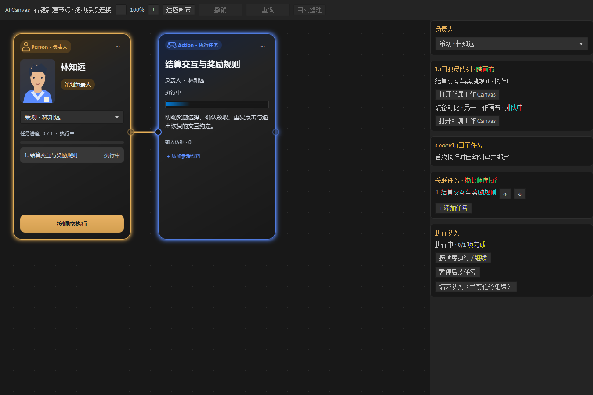
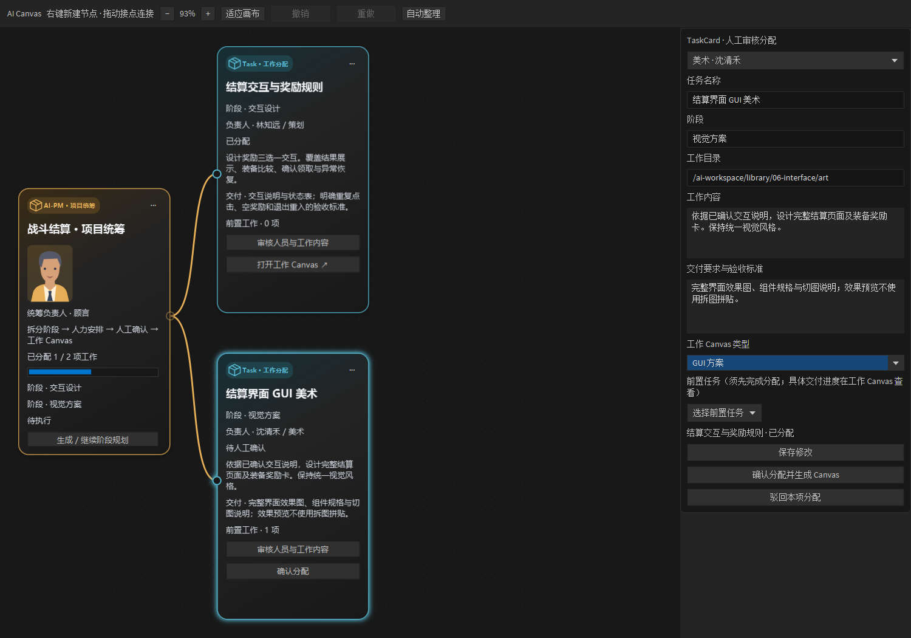
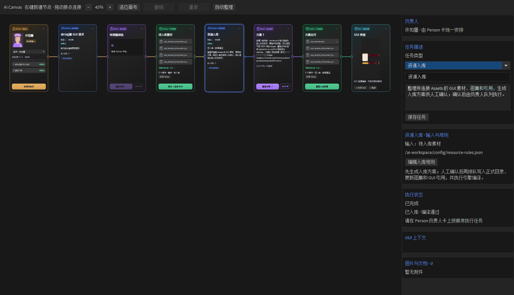

# AI Canvas editor integration

Open a GUI resource and choose **进入 AI 模式**. The editor provides Person, Action, Result, Assets and GUI cards, card-scoped conversations, attachments, streaming replies, and project-owned records stored directly under `ai-workspace/`. The local Companion connects staff conversations and execution only; document management does not use its upload, download or archive APIs.

GUI workflows use **Result → Assets → GUI**. Result contains complete screen proposals; component sheets (`*_components.png`, sprite sheets, or explicit `component-sheet` outputs) are offered separately on Assets. The GUI card binds a project `.gui` resource and displays its native resource rendering above the compact open/refresh controls. The inspector can bind a different final GUI, for example after gameplay integration. Previewing enables page roots in a private graph basis and removes editor outlines; scripts and runtime-generated content do not execute, and source files/undo history remain unchanged. New GUI documents include this card, and existing GUI deliveries acquire it on opening. Re-adopting upstream art marks the downstream GUI stale until regeneration or explicit binding.

Use **视图 → AI 模式** or **Ctrl+I** to enter from any project view. Reindent now uses **Ctrl+Shift+J**.

## Project roles

**AI 工程 → 项目配置 → 项目职能** opens `ai-workspace/config/project-roles.aicanvas`. Role definitions come from the editable project catalog **职能配表**, stored at `ai-workspace/config/role-types.json`. Planning, art, programming, PM and QA are initial templates, not a fixed role list. Each catalog entry becomes a colored row; array order controls row order. Add staff at the end of a row, or select a staff card and change its role in the inspector. Staff IDs, names and task/chat bindings remain stable. Existing producer cards migrate to PM. Use the wheel to scroll rows and Ctrl+wheel to zoom. Search filters staff names, assignees, models and roles without changing saved data.

Open **职能配表** to edit and save the JSON in an AI Canvas child tab. The expandable field guide explains the schema. Returning to the staff tab refreshes its rows and appearance without recreating the left browser. New staff use the selected role's defaults and random name pool; exhausted pools receive unique numeric suffixes. Existing staff retain their edited parameters, including explicit empty strings and disabled state. **应用所选职能的默认参数** fills the inspector from the catalog; **保存配置** commits the change, and **重置** restores the saved staff values. Missing legacy fields receive defaults. These edits do not start tasks.

The catalog has `format: "codexcamp.role-types"`, `schemaVersion: 1`, and a `roles` array. Each role supports:

| Field | Meaning |
| --- | --- |
| `id` | Stable lowercase identifier, e.g. `audio_designer`; may include digits, `_` and `-`. Referenced IDs cannot be removed through the editor. |
| `title`, `color` | Display name and `#RRGGBB` accent color. |
| `icon` | `planning`, `art`, `programming`, `pm`, `qa`, `person`, `model`, `document`, or `status`. |
| `portrait` | Illustrated avatar style: `planning`, `art`, `programming`, `pm`, or `qa`. |
| `namePool` | Nonempty array of candidate staff names. |
| `initialCount` | 0–20 staff created when the project's staff document is first created. Changing it does not add/delete existing staff. |
| `defaults.assignee` | Default owner/person identifier. |
| `defaults.model`, `defaults.effort` | Model family or exact model ID, and `低`, `中`, `高`, or `极高`. Actual availability is checked against Companion before execution. |
| `defaults.enabled` | Boolean staff enabled state. |
| `defaults.responsibilities`, `defaults.deliverables` | Task instructions and delivery requirements. |

To reuse a catalog, copy only `ai-workspace/config/role-types.json` to the same location in another project. Copy before first opening Project Roles to use `initialCount`; an existing project retains its staff and requires the IDs they reference. Staff instances (`project-roles.aicanvas`) and conversation archives are separate and are not part of the portable role template. Invalid catalogs and stale editor saves are rejected without overwriting the file. Catalog changes also appear in normal project archive synchronization.

Role edits use the canvas undo/redo history and document conflict checks. Reopening preserves existing assignments. Assign staff on Person cards; Actions inherit the connected Person's current responsibilities, deliverables, model and reasoning effort. Action cards have no staff selector or execution button. Invalid or missing Person configuration blocks the entire downstream chain. Person owns the reusable CodexCamp project task and its ordered work queue.

Design actions request candidate images. Adopting a candidate enables the Assets splitting editor, semantic component names and module directories, editable GUI/atlas production, resource validation and native editor preview. Migrated archive previews are accepted after checking candidate identity and archive content hashes.

Canvas controls include middle-button panning, zoom, double-click card focus, a following details pane, right-click deletion, and up to 100 session-local undo/redo steps. A card drag is one operation. Camera and selection changes do not consume undo history. Deleted cards retain their archived files and conversations. Text inputs retain native text undo.

The editor uses native theme colors and distinct card borders. The macOS paste fallback handles the JDK clone-path `Operation not permitted` failure without retrying unrelated permission errors. No runtime engine code is changed by this integration.

## Person and ordered tasks

Right-click blank canvas space to create a Person, Action, Assets or GUI node at that location. Result cards are generated by their source Action. Drag an output pin to an existing compatible input, or release over blank space to choose a supported downstream node: AI-PM → Task, Task → Task (prerequisite), Person → Action, Result → Assets, Assets → GUI. AI-PM can own several TaskCards; dragging works before a project goal is saved, and the TaskCards it creates are registered to that AI-PM (source-pm) with the built-in AI-PM staff assigned. Action → Result connections are created automatically and cannot be disconnected or reassigned. The new node and connection are one undoable operation. Esc cancels a wire drag. Node coordinates account for canvas pan and zoom. Person can own multiple Actions; the inspector's up/down controls set their execution order. The inspector's **添加任务** shortcut also creates only one Action.

New Person, Action and AI-PM cards are assigned the built-in AI-PM staff by default; choose another enabled staff member to take over. Choose an enabled staff member for Person before dragging its output. The staff member must have a role, name, model, reasoning effort, responsibilities and delivery requirements. Action requires a saved task description. Invalid output pins and execution buttons are disabled. Connections store configuration fingerprints for both endpoints; editing a task or its staff configuration preserves existing wires as gray dashed lines and blocks downstream execution. Right-click a wire and choose **重新确认连接**, or drag again to the same input, after fixing configuration; **断开连接** removes ordinary links; fixed Action → Result links only allow reconfirming configuration. Invalidity propagates through the entire downstream chain and survives reopening. The editor rechecks the current project staff document at dispatch time, independently of cached UI state. Generated results and node movement do not invalidate configuration.

Write each Action's task content in the bottom AI input of the Action card; **保存** stores it on that card, and selecting the card loads it back into the input. The inspector does not edit the task text. **按顺序执行 / 继续** submits one task at a time using the selected staff member's current responsibilities, delivery requirements, model and reasoning effort. The next task starts only after the acknowledged turn reports completion. Cards display queued, submitting, running, waiting for confirmation, completed, failed or interrupted states; running tasks show an indeterminate progress indicator and the Person shows completed/total tasks. No percentage is inferred from elapsed time.

Failures and interruptions pause the queue. **暂停后续任务** lets the current task finish; **结束队列** removes unstarted work without interrupting the current turn. Pending request IDs survive retries to prevent duplicate submission. Reopening pauses saved queues and reconciles in-flight turns before allowing continuation. Task edits, assignment changes and graph edits are locked while a queue or acknowledged task remains active. Actions and Result confirmation jobs share the responsible staff member's CodexCamp task, with per-card turn attribution.

## 项目人员队列与任务台账（首版）

同一项目内，同一职员在不同工作 Canvas 中的任务统一登记在 `ai-workspace/project/work.json`。Person 详情新增 **项目职员队列 · 跨画布**，显示该职员正在执行、排队、暂停及待核对的工作，并可打开所属 Canvas。队列只允许该职员的一项运行取得执行权；其他职员仍有自己的顺序。

入队记录保存具体职员、任务与执行规格快照、Canvas/Action/Task 身份；确认分配同时登记工作 Canvas 的稳定身份与 Action ID。工作文件移动或改名后，打开入口按 Canvas ID 在创作资料目录内重新定位，发现重复身份时停止并提示冲突。重新排序旧连线不会重排已登记的队列。

暂停、结束队列及关闭工作视图只处理尚未运行的工作，不把远程执行伪装成已取消。重连会核对已有 thread/turn；unknown 保留执行占用，未确认的请求只能按原 request ID 重试。收到晚到的 running 状态不会覆盖已知终态。失败后的新尝试保持它相对本画布后续工作的顺序。Task 的工作状态回流到 PM，模型回合完成显示 **待验收**；人工验收通过后才显示 **已验收**。

新建 Person 与手动 Task 不再静默指派内置 AI-PM，必须明确选择制作职员；Action 只通过 Person 解析执行配置。PM 卡仍使用规划身份，旧卡片的指派保留。

Windows 本轮验证：152 项编辑器相关回归、1332 条断言通过；Companion 100 项库测试通过；修改文件 clj-kondo 零错误/警告。通过真实 CodexCamp API 完成一次 PM 请求：聊天自动归入游戏项目、重复请求复用同一 turn、回复元数据回显、编辑器解析出两项待审任务，隔离确认生成两个 Person→Action 子画布。验证聊天随后归档。原生队列界面也通过 cljfx.plorer 检查。

编辑器仅热加载，未打包。真实 PM 往返使用本机开发 Companion `8771`，该服务已更新并恢复桌面桥接；当前正式 Companion `8769` 未替换。PM 在服务不支持 `pmPlanning` 时会给出更新提示，不再发送不兼容请求。



## 资产版本、成果准入与工程验收

Result 确认和 Assets 批准建立不可变文本/文件版本。Action 可选择多个已批准版本，也可连接已批准 Assets；真正执行前锁定输入与前置 Task 验收。阻塞项不占职员执行权，独立后续工作继续。旧批准不跟随源文件或新生成内容变化。

Task 分配前可选择文档、资产包或工程集成交付。工程入库自动记录正式文件、依赖、引擎构建编号和对应 GUI；源 Task 详情可登记运行/视觉检查证据、验收通过或退回。验收更新 PM 阶段统计及后续工作准入。完整操作和验证边界见 [交付工作流](doc/ai-delivery-workflow.md)。

本批 Windows 验证：160 项回归、1385 条断言通过，包括真实资源编译到交付收据及 Task 验收回流；运行/视觉检查接口通过契约测试，未代替真实游戏人工验收。已会话热加载，未打包安装。

## AI-PM 阶段规划与人力分配

在左侧创作资料分类目录右键，选择 **新建 Canvas · AI-PM · 项目规划**。也可以在画布空白处右键添加 **AI-PM · 项目统筹**。新建的规划画布自带一张已指派内置职员 **AI-PM** 的 PM 卡，填写并保存项目目标、阶段约束与交付范围，再点击 **生成 / 继续阶段规划**。内置 AI-PM 职员在职能画布中只读，不能改名、改配置、停用或删除。即使还没填写项目目标，也可以从 PM 卡右侧接点拖出引线直接追加 TaskCard，新任务登记在这张 PM 卡名下，制作职员保持待指派；填写并保存项目目标后才能「生成 / 继续阶段规划」。

AI-PM 使用现有 CodexCamp 项目和职员子任务绑定；提交前将聊天命名为 `【职能-名字】规划名`（例如 `【PM-AI-PM】阶段规划`），继承该职员的模型、思考强度和职责。请求包含所有已启用职员（支持自定义职能）的职责、交付要求及当前规划的已有分配记录，要求返回结构化的阶段和任务。PM 只规划；完成的有效回复才会生成 **Task · 工作分配** 卡，部分回复、格式错误、人员不存在或循环依赖均不会创建工作文件。

每张 TaskCard 包含阶段、具体职员、任务描述、交付与验收要求、工作目录及 Canvas 类型。前置任务不再是勾选列表：把一张 TaskCard 的输出接点拖到另一张 TaskCard 的输入接点即可建立前置关系（可多条，禁止自连和循环），右键连线可断开；卡片详情只读展示前置任务及状态。选中卡片后修改内容并 **保存修改**，再逐项 **确认分配并生成 Canvas**，也可以驳回；这些操作收拢在详情底部，先保存修改再确认/驳回。只有确认操作会创建工作文件，未保存的审核修改会阻止确认。前置任务须先完成分配。重新规划保留已分配工作，将旧待审任务标记为已替代，不自动批准新任务。

工作目录限定为 `/ai-workspace/library/` 的现有分类及其子目录。每次确认生成一个独立 `.aicanvas`，包括已绑定职员的 **Person → Action**，填入任务、阶段、验收要求和前置工作 Canvas 路径。支持文本、GUI、角色与怪物、场景与关卡、数值与配置五类工作 Canvas。文件名带稳定任务后缀；重复确认或文件创建后重试会复用原文件，保留后续人工编辑，不覆盖已有其他工作。成功分配会清空规划画布的撤销历史，避免撤销造成文件与审批状态不一致。

点击 **打开工作 Canvas** 在当前 AI 窗口内打开任务，由 Person 继续原有执行链路。此阶段实现的是人工确认后的分配，不会自动启动所有职员，也不是跨 Canvas 的运行时依赖调度器；工作开始前应核对前置交付物。任务详情及提示词明确保留这项要求。PM 人力概览统计当前规划的待审/已分配任务，不将其冒充为实际工时或跨项目负荷。

早期隔离验证记录：137 项相关回归、1242 条断言通过；包括规划解析、审批边界、依赖循环、目录约束、重复分配、人工文件编辑保护、保存重开及原生审核控件。通过当前 Defold 的 cljfx.plorer 检查原生界面，并在隔离目录确认生成 Person/Action 工作 Canvas。未触发真实模型请求，未将该结果作为模型拆分质量或实际工作执行的验收。当前会话热加载，安装包未更新。



## GUI 资源入库

在已经拆分生成 GUI 的 Assets 卡片上右键选择 **新建资源入库 Action**，或从 Assets 接点拖出 **Action · 资源入库**。右键入口默认沿用原流程的 Person；也可以断开 Person 连线并连接另一位负责人。Assets 输入与 Person 归属是两种独立连线；资源变化会使入库输入失效，需要重新确认。普通创作 Action 不能接收 Assets 输入。

负责人执行入库 Action 后先产生一个 Result 入库方案，不改写正式目录。方案列出图片、Atlas、GUI 的目标路径及 create/reuse/conflict 操作；在右侧或 Result 详情窗口可编辑 JSON 中的 target。重名不同内容默认阻止执行；确认替换时显式将对应 operation 改为 replace。修改目标到已有文件时，应重新生成方案获得目标内容快照，不能省略冲突检查。

确认方案会追加到原 Person 的队列尾部，既有 Action 继续执行。确认任务开始前会重命名其 CodexCamp 子任务，然后由本地确定性工具复制资源、改写图集路径及 GUI 纹理引用，保留原始 `ai_generated` 产物。职员对话只记录执行结果，不再次让模型操作资源文件或生成候选。

Action 详情的 **编辑入库规则** 打开 `ai-workspace/config/resource-rules.json` 原生编辑子标签页，支持保存和重载，可复制到其他项目复用。`gui.images`、`gui.atlas`、`gui.scene` 使用 `{module}` 作为模块占位；`maxImageSize`、`maxAtlasSize` 设置尺寸上限，`innerPadding`、`extrudeBorders` 设置图集留白与边缘扩展。规则保存在每份方案快照中，修改规则只影响之后生成的方案。

默认正式资源位置：

```text
/assets/ui/{module}/*.png
/assets/atlases/ui/{module}.atlas
/gui/{module}/{module}.gui
```

写入前后均核对资源内容指纹。GUI、Atlas、纹理和材质依赖在独立的工程图和 `.internal/ai-resource-import/<id>/build` 内执行真实引擎编译，不修改当前编辑器的 undo 图，也不清理已有 `build/default`。失败时按事务备份回退；遇到同时发生的人工修改时保留人工文件并报告冲突。事务记录和备份保存在 `.internal/ai-resource-import/<id>/`；相同方案重试不重复入库，崩溃后的未完成事务会先恢复再执行。

规划阶段也检查工程中的 GUI、图集、组件、集合、材质、模型和 Lua 脚本等资源文件，列出直接引用旧路径的文件；执行时一并改写、备份并编译这些资源。只替换完整的引号字符串，保留其他代码；GUI 使用原生结构更新纹理路径和帧名。新增、修改或删除外部引用会使已有方案失效。扫描跳过暂存、构建、归档及隐藏目录，单文件上限 8 MiB；动态拼接的 Lua 路径需要人工处理。

执行前和编译后都检查编辑器中相关资源的未保存修改；存在未保存编辑时停止入库，保留编辑器草稿。不会为了完成入库而自动保存或覆盖这些修改。

成功后产生 **已入库 · 编译通过** Assets 和绑定正式 `.gui` 的 GUI 卡片，归档交付文件并刷新预览。编译通过与视觉验收分开记录。第一版处理现有生成清单中的 GUI PNG、单个静态图集及 GUI；完整效果图与源截图不作为运行时素材入库，暂不处理动画图集或自动跨模块合并图集。超出图集限制会明确失败，保留待调整的方案。

Windows 验证：相关回归 132 项、1191 条断言通过，包含外部组件引用的真实引擎编译、事务回退、未保存编辑保护及 JavaFX 控件。现有战斗结算的 5 张素材在隔离副本中入库，入库前后原生 GUI 预览像素一致；这不替代视觉验收或真实 Companion 模型调用验收。当前会话已热加载，安装包未更新。



## Result proposals and arrangement

Each Action can produce multiple Result cards, one proposal per card. Explicit `## 方案 A：名称` / `## 方案 B：名称` headings separate text proposals; headings inside code fences do not. Old multi-candidate Results split on opening, keeping the adopted proposal's original card and downstream branch. No migration submits a task.

The Action context menu offers **查看方案** for one produced Result and **对比方案** for multiple Results. Empty placeholder Results do not count. Single-result viewing reuses that Result's existing resource/details window, including Markdown editing and file-manager actions. Browsing remains available independently of task execution eligibility.

The comparison window has distinct left/right proposal selectors, swap and refresh controls, saved-version metadata and an **打开完整详情** button for each side. A common content selector pairs the current bodies, primary effect images and files with the same names, retaining repeated files and one-sided resources. **阅读预览** renders Markdown, images or text side by side with optional proportional scrolling. **文本差异** uses the editor's HistogramDiff implementation, aligns changed/added/removed lines with line numbers, and marks sides with both color and minus/plus indicators. Its rows are virtualized. Images and binary resources use reading mode; text over one million combined characters also uses reading mode. Historical source/confirmed snapshots remain accessible through full details. Comparison is read-only; after saving changes in full details, Refresh reloads the current proposals and keeps valid selections. Reopening an Action comparison reuses its window.

Result details contain only the proposal, manual edits and selection status. Edit text, replace an image, or add/remove files, then save or confirm. Imported files are content-addressed project archive copies. Snapshot replay preserves manual and confirmed versions. Action details retain the task and conversation; Result, Assets and GUI do not display the conversation/composer.

**确认此方案** saves current edits, adopts that version into this Result's independent Assets branch, and appends a confirmation job to the same Person queue. Remaining Actions continue first; they never wait for proposal selection. Multiple proposals can be confirmed. Repeated confirmation of the same queued/completed revision does not resubmit; queued or retrying versions cannot be edited. A completed proposal can be edited and confirmed as a new revision. Confirmation replies cannot overwrite proposal contents. Person cards and details show confirmation jobs alongside execution status. GUI generation checks both candidate identity and selected revision; an old splitting window cannot publish a newly selected revision.

Workflow cards share a 268 × 470 canvas size. Their list scrollbars are 5 px wide and appear during pointer/scroll activity, hiding after 900 ms idle. The toolbar's **自动整理** places Person, Action, Result, Assets and GUI in separate columns, preserves Action execution order, reserves vertical space for all proposal branches and places disconnected cards separately. It then fits the view. Arrangement changes only positions, is deterministic, and is one undo operation. Manual positioning remains available; new outputs do not continuously rearrange the user's canvas. Arrangement is unavailable while the execution queue is active.

## AI project directory

Result and Assets cards offer **在新窗口查看详情** in their context menu. The independent window uses the native project resource tree on the left and previews the selected proposal, image, Markdown document or text/configuration file on the right. Unsupported binary formats can be opened in their corresponding application; GUI and Atlas originals open in the editor. Refresh preserves the selected entry, and reopening the same card reuses its window. Missing local files remain listed. The preview inherits the editor theme and the Markdown reading theme; its toolbar uses compact vector icons without a path bar.

The details window can edit project-local `.md` / `.markdown` files and the current Result body. The pencil toggles source editing and draft preview; Save or Ctrl/Cmd+S writes changes, and Cancel discards the draft. During editing, resource selection and refresh are disabled. Closing the window with unsaved changes requests saving or cancelling first. File saves check the original contents and replace the file atomically; conflicts or write failures retain the draft. Result body saves use the existing manual-edit and confirmation-lock rules and refresh the card/details. Original and confirmed Result snapshots remain read-only. Markdown files larger than 8 MiB are not editable in this window.

File-bearing surfaces provide **在文件管理器中显示**: the AI project tree, document tabs/previews/source, Result/Assets resource trees, card file rows and image previews, GUI resources and task attachments. On Windows this opens Explorer and selects the file; folders open directly. Right-clicking a tree row targets that row, even if another row was previously selected. Virtual proposal text and missing local files cannot invoke the action. Source editors retain editing commands. The standard editor **Show in Desktop** command uses the same file selection behavior.

Workflow cards use gold Person, blue Action, purple Result and green Assets accents over the engine's background palette. Main text stays bright, secondary text remains readable, and completed status uses mint green separately from task names. Filled accent buttons use dark text. Cards summarize long proposals and show real images and file rows; the details window retains the complete content. Person progress uses actual completed task counts.

Canvas messages share a top Toast stack. Information expires after four seconds. Warnings persist with a close control; identical background retries do not restore a dismissed warning until the condition recovers or changes. Errors persist without a close control. An explicitly recovered condition can resolve its own error. Upload failures that retained a local copy are warnings. This changes notification presentation, not the underlying upload service.

The tree uses the same native cells, tree skin, 16 px resource icons and resource color classes as Assets. The editor theme supplies row spacing, disclosure arrows, hover and selection states. The list fills the panel without an inset border or permanent detail footer; descriptions and paths are available in row tooltips. Compact import and refresh icons live in the header. The existing category import rules, context menus and persistent tree-item identity are retained.

The left pane lists the current game's `ai-workspace/` using native tree controls. `library/` contains ten creative categories: concept/gameplay, world/style, characters/monsters, scenes/levels, systems, interface, motion/effects, audio/music, balancing/configuration, and testing/delivery. Each category has a starter README; reopening never overwrites authored files. Existing conversations, canvases, attachments, candidates and delivery archives retain their original locations.

The project has one **AI Canvas** workspace tab. Its left AI project tree stays mounted while documents open, close or switch in the right-hand tab strip. Reopening a document selects its existing tab. Creating a document refreshes directory children in place, retaining existing folder objects, expansion and selection without resetting the tree or scrolling to another item. Closing a child tab saves and disposes only that view; closing the workspace disposes all its views.

Expand folders to browse, double-click a file or press Enter to open it, and use Refresh to read external changes. Canvas documents retain their own editing state in child tabs. Text and images open as read-only previews in the same workspace; **打开原文件** opens the original in its system application. Other file types offer that button without an embedded preview. Select a category folder to import files up to 64 MiB each; duplicate names receive numbered suffixes. Category documents and imports use the existing CodexCamp archive synchronization. Category selection does not change canvas/card ownership.

## Local document ownership

Documents, attachments, previews, version snapshots and delivery receipts are managed directly by the editor on the local filesystem. Opening/importing/editing documents and refreshing the library do not require Companion. Task messages include validated local attachment paths and hashes, so the local worker reads the same project files; images are opened by its image-viewing tool.

The archive sync button, automatic bidirectional synchronization, file uploads/downloads and connection-time scan of all historical chats have been removed. Existing `sync.json` is retained but ignored and hidden in the project list. Existing project IDs, documents, approvals and frozen versions are preserved. Companion APIs remain available to its other clients; Defold no longer calls them for file management.

See [local document workflow](doc/ai-local-documents.md) for ownership, migration, retained review gates and remaining management improvements.

## Standalone text Canvas

Markdown (`.md` / `.markdown`) opens in AI Canvas child tabs using Defold's native Markdown view and the existing [commonmark-java](https://github.com/commonmark/commonmark-java) dependency. The reading area adapts the proportions of [github-markdown-css](https://github.com/sindresorhus/github-markdown-css) and the GitHub Night dark-dimmed direction: a centered column up to 980 px, 16 px body text, generous line spacing, distinct headings and quiet table/code surfaces. These styles are scoped to Markdown; other editor views retain their theme. Three 24 px vector icon buttons float in the upper-right corner for source/preview, refresh and external opening. Tooltips explain each icon; the path and full-width toolbar are hidden. Source/preview switches between read-only source and rendered content; refresh rereads the saved UTF-8 file. Relative images resolve from the document location and local document links open in workspace child tabs. External links retain the editor's normal browser behavior. **打开原文件** remains available for editing in an external application. Preview is limited to 8 MiB per Markdown file.

Right-click a creative category to create a `.aicanvas` document: text proposal, GUI proposal, art proposal (characters and monsters / scenes and levels), or balancing and configuration proposal. Each template provides its own Action/Result/Assets labels and generation brief. Text and balancing proposals produce text; GUI and art proposals require image candidates. GUI candidates use the existing split/GUI production workflow, while adopted art proposals export Markdown with project-relative references to their cached images and proposal text. Existing text documents retain the concept template. The AI command also opens project planning without a GUI selection. Action requests text proposals; completed replies become selectable Result candidates. Adopt a candidate into Assets and explicitly export a source-linked Markdown version without overwriting previous exports. Card details show the full proposal and export path.

Canvas/Card IDs remain stable across file moves. Semantic document revisions exclude camera and card-position edits; presentation and sessions retain the existing archive storage. Unknown document versions open read-only, and external document edits are not silently overwritten. These templates share the linear proposal workflow; they do not implement the complete typed-port, memory-system or production-adapter roadmap.

The connection tooltip distinguishes native project binding from Codex desktop sidebar membership. A pending sidebar projection does not imply a failed model connection, and a working task does not imply confirmed sidebar grouping.

## Validation and delivery

Action proposal viewing/comparison passes 110 targeted Windows tests with 1093 assertions and clean checks for the changed Clojure files. Coverage includes zero/single/multiple Result menus, placeholder filtering, resource pairing, CRLF-normalized line alignment, distinct selectors, swaps, refresh/removal, scrolling, cached image previews and existing Markdown editing. Live checks exercised the core-gameplay Action's two Results in reading/difference modes, window reuse and opening full details; the document Action's single Result opened the same existing details component. Both canvas tabs and the project browser were retained. This update is hotloaded, not packaged.

File-manager navigation passes 105 targeted Windows tests with 1055 assertions. Live verification right-clicked an Assets document and confirmed Explorer's selected item matched the exact Chinese Markdown path, rather than only opening its parent folder. Tab/file-tree menu availability was checked without replacing the persistent project browser. The implementation is hotloaded, not packaged; macOS and Linux launch commands have not been verified on those hosts.

Markdown editing passes 102 targeted Windows tests with 1039 assertions and clean clj-kondo checks. Tests cover UTF-8 saves, project boundaries, external-change conflicts, draft retention, preview switching, close protection, Ctrl+S and read-only snapshots. Live checks exercised the real Result save callback without changing its proposal, and saved edited Markdown through the window to a temporary file. This update is hotloaded, not packaged.

The card theme, resource window and Toast update passes 99 targeted Windows tests with 1020 assertions and clean clj-kondo checks. Live checks covered Result/Assets context menus, window reuse, resource switching, themed Markdown, persistent warning/error controls, card dimensions, Person-only execution and readable Person text/progress. Changes are hotloaded into the current editor session; installed files are unchanged.

The multi-Result and automatic arrangement update passes 94 targeted Windows tests with 990 assertions and clean clj-kondo checks. Live editor verification checked fixed provenance, one proposal per Result, 268 × 470 card dimensions, Result-only details without conversation/composer, and arrangement of the current core-gameplay canvas: 8 cards, zero overlaps, stable repeated arrangement, and undo/redo restoring positions. The same project browser and all 4 child tabs were retained. Queue sequencing and duplicate/retry handling were tested locally; this check did not send real model generation or confirmation requests. The update is hotloaded into the current session, not packaged.

Markdown workspace preview passes 68 targeted Windows tests with 680 assertions (the existing symlink-privilege test remains excluded). Live editor checks covered project Markdown rendering, source/preview switching, refresh, and a relative document link opening a child tab while retaining the same project tree. This update is hotloaded into the current session and is not packaged.

The persistent workspace update passes 67 targeted Windows tests with 667 assertions. The Windows symlink-privilege boundary test remains excluded. Live REPL checks opened a document inside the workspace, reused its tab, and closed that tab while retaining the same browser and root tree objects. The current editor session is hotloaded; this update is not packaged.

The blueprint-style interaction update passes 62 targeted Windows tests with 637 assertions and clean clj-kondo checks. Live REPL verification covered blank-canvas creation, disabled unconfigured Person pins, typed drag-out menus, connecting to existing inputs, gray downstream links after external staff edits, explicit reconnection and Esc cancellation. An isolated HTTP service received zero requests from invalid Action/Person execution attempts; after reconnection it received one task, whose completion updated the Result candidate. No real model generation was used for this check. The update is hotloaded into the current editor session and is not packaged.

Person queues were validated on Windows with 57 targeted tests and 589 assertions, including graph ownership, ordered dispatch, old-turn rejection, recovery, persistence and JavaFX controls. The Windows symlink-privilege boundary test was excluded. A live editor using an isolated local test service submitted exactly two tasks in order: the second remained queued until the first turn completed, both reached completed, and reopening did not resubmit them. This verifies dispatch and status handling without sending a real model generation request. The implementation and theme changes are hotloaded into the running patch.110 editor; they are session-only until packaged.

On macOS, the combined archive, production, canvas, conversation and filesystem-copy tests pass: 36 tests, 184 assertions. Live editor verification covered card details/focus, image reuse, middle-button panning, deletion and keyboard undo/redo, and opening an adopted candidate in the splitting window.

The local application is patch.109. The AI project directory addition is currently hotloaded for validation; restarting with that addition requires the next incremental package. Directory regression tests pass: 3 tests, 12 assertions. Live verification covers the ten categories, selection/expansion retention, native document opening, and ten category documents archived in CodexCamp. This source branch does not publish a release. The independent Remote Manager working-tree edits are not part of this change.

Codex desktop sidebar project membership remains an integration limitation. Backend project binding must not be presented as proof that a conversation is visible under the desktop sidebar project. See the Companion feature branch integration notes before installing its experimental project-registration changes.

Standalone Canvas and task-flow verification used a hotloaded editor and an isolated Companion service: real text generation, Result adoption, Markdown export, event-stream reconnection and tab reopening retained the same task with one completed turn. The combined Canvas/document/workbench/browser suite passed 29 tests and 159 assertions before the sidebar-status addition; the later workbench/document suite passed 14 tests and 67 assertions. These changes have not been packaged into the installed editor. No runtime engine changes are included.

### 职员子任务绑定

Person 按项目职员的稳定 ID 复用 CodexCamp 子任务，同一职员关联的多个 Action 共用模型上下文。每个任务提交前先通过 `/api/thread/name` 更新为 `【职能-名字】任务名`（例如 `【策划-徐如墨】写战斗玩法`），收到改名成功回执后才发送任务。改名和消息使用持久请求编号，重试保持原始目标和标题。Person 详情显示绑定的子任务名与编号。连接 Companion 本身不再预创建聊天；首次执行时由 `/api/project/ensure` 自动建立项目和职员绑定。

Codex 后端 `projectId` 与桌面侧栏归组是独立状态。界面只在收到明确侧栏回执后显示“侧栏已归组”，不能将后端创建成功当成侧栏验收。
