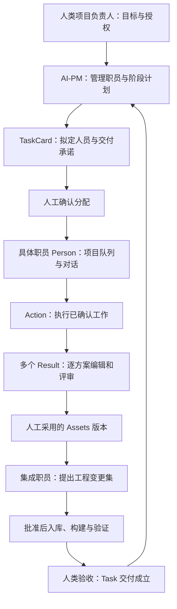

# AI Canvas：以人员为主的流程审查与推进方案

审查日期：2026-11-04。

执行进度（同日）：批次 0、1 已完成。当前补齐资产不可变版本与人工批准、普通 Action 多输入及成果执行准入，以及现有 GUI 入库范围内的工程回执、QA 证据和人工验收回流。PM 重规划差异审核、通用脚本变更集及更多资源类型仍列为后续扩展；不把这些扩展计作已完成。详见 [交付工作流](ai-delivery-workflow.md)。

当前编辑器证据：160 项测试、1385 条断言，含真实资源编译及交付验收回流。上一批 Companion 100 项库测试、真实 PM API 往返和隔离分配证据保持有效，本批未重新执行 Companion 测试。编辑器仅会话热加载；Companion 更新运行在开发端口 8771，正式安装服务 8769 未替换。参见 [当前实现说明](X:/AI/UI/defold/editor/README_AI_CANVAS.md:50)。下文保留原始审查基线，已修复项以本段和实现说明为准。

本方案对照用户的《AI Canvas 卡片模型审查与改进建议》、当前 Defold 和 CodexCamp 本地源码编写。附件中的命令式建议作为待评审提案，不作为本轮修改指令。本轮没有修改业务代码、运行模型任务或进行游戏验收。

当前安装配置和源码发布配置均显示 `1.14.1-patch.111`；工作区仍有未提交修改。安装配置不能证明所有当前源码都已进入运行中的编辑器与 Companion。下面分别标注源码事实、静态推导风险和建议，不沿用上一轮“patch.110 热加载”的状态，也不把此前测试数量作为本轮验证结果。

## 1. 结论与必须保留的产品原则

附件的主要方向值得采纳：明确责任、冻结产物版本、区分执行与验收、打通工程交付。但应把它改成“补齐人员协作闭环”的方案，不能直接按全部条目重构卡片系统。

当前最重要的缺口是：**分配之后，缺少一份贯穿人员、执行、成果、入库和验收的项目级工作记录。** 所以 PM 能知道工作已分配，却还不能可靠地知道谁交付了哪个版本、谁在等谁、哪项承诺已经验收。

继续保留用户已经确定的规则：

- **Person 统一启动执行，Action 不增加执行按钮。** AI-PM 自己的规划按钮属于管理流程。
- **一个方案一张 Result，同一个 Action 可以有多个 Result，各方案都可分别采用并推进。** 同一运行的 Result 可以分组折叠，但不合并回一张多候选卡。
- **独立 Action 可以继续执行，方案确认另行排队。** 有真实成果依赖的任务才等待相应交付，不以“存在任何待审核 Result”暂停整个人员队列。
- Task 分配、方案采用、正式工程变更与最终验收分别记录；界面可以合并展示，不能把批准一种行为当成批准全部后续行为。
- 左侧工程树常驻，相关内容仍在 AI 窗口内用 Tab 打开。历史资产的查看、编辑新草稿与正式执行资格分别处理。

## 2. 将“以人为主”落实为清楚的责任关系

这里把“管理人员”理解为用户本人或项目负责人；“管理职员”对应 AI-PM 的计划与人力管理职责；“人员”是被明确指派的具体职员。不再为这三个词增加三套同义卡片。

| 层次 | 对应现有能力 | 应负责什么 | 不能混淆的边界 |
| --- | --- | --- | --- |
| 人类管理者 | 项目操作人与审核入口 | 决定目标、范围、人员分工、正式写入与最终验收 | AI 的建议不能代替人的批准 |
| AI-PM | PM 卡、阶段与 TaskCard | 拆分阶段、建议人力、安排依赖、汇总进展、提出变更 | 不默认承担未指派的制作任务，不自批成果 |
| 职能定义 | `role-types.json` | 可迁移的职能、能力、默认职责与交付要求 | 职能模板不是具体职员 |
| 具体职员 | 项目职能中的职员实例 | 稳定身份、模型配置、职责、项目工作队列、对话绑定 | 同名不等于同人；模型变化不创建新人员身份 |
| Person | 工作 Canvas 中的职员引用 | 展示该职员在当前工作中的责任和队列，发起执行 | 多张 Person 引用同一职员时，不能变成互不知情的多个调度器 |
| TaskCard | 交付承诺与管理入口 | 记录执行人、审核人、交付标准、依赖和最终结果 | `allocated` 只表示已分配 |
| Action / Result / Assets / GUI | 执行与交付记录 | 执行步骤、候选、批准产物、工程绑定和验证证据 | 不能各自再产生一套负责人或任务完成定义 |

主线应形成闭环：



策划、美术、程序、QA 可以由不同职员承担，也可由同一职员兼任；无论是否兼任，制作、检查、批准、集成的事实都要区分。角色停用只影响未来工作，不删除既有贡献或冻结已交付资产。

## 3. 附件哪些应采纳、哪些需要改写

| 附件项 | 对照当前源码的结论 | 本项目处理意见 |
| --- | --- | --- |
| F01 负责人与输入混淆 | **核心区分已有。** Assets 输入与 Person 归属分槽，入库 Action 可同时有两者；第二个 Person 被拒绝。快捷入库仍会继承素材生产链中的 Person。 | 改成“已有分槽，补显式关系与转交”。保留独立集成人，不能由素材作者永久决定入库负责人。[S1][S2] |
| F02 分配依赖代替成果依赖 | **缺口成立。** Task 依赖线与判环已有；分配仅检查前置已分配和文件存在。依赖交付要求被写入提示词，没有成为执行准入，也没有交付回流。 | 允许提前分配；执行时等待所需的批准交付版本。补任务与工作 Canvas 的稳定关联。[S3] |
| F03 回合完成等于任务完成 | **拆状态建议成立，原现状描述需纠正。** 当前代码并不会在每次 Result 生成后等待人工选定；`waiting` 来自远程问题/审批，回合结束会继续剩余队列。 | 保留用户原来的继续执行规则。另建 Task 交付/验收状态，不修改远程回合状态来冒充验收。[S4] |
| F04 配置指纹覆盖历史 | **缺口成立。** 标题、需求、人员配置使用同类指纹；来源边也有重新确认入口。 | 显示修改、需求版本、产物版本分离；冻结产出来源，重新确认连线不能重新解释历史成果。[S1][S5] |
| F05 Result 修改与批准 | **部分已有。** 内容摘要、原始候选、确认快照、排队锁、同版本幂等已实现。缺完整追加式修订与批准日志、统一文件清单校验。 | 在现有多 Result 上补版本链和批准记录；不采纳“一 Run 一张多候选 Result”的卡面改法。[S6] |
| F06 通用 Assets 输入 | **限制确认。** Assets 目前只能输入资源入库 Action；普通 Action 的附件不等于受版本约束的正式输入。 | 先开放批准文档包与 GUI 资源包的多输入、只读复用；再扩展其他资产类型。[S1] |
| F07 全画布锁 | **部分成立。** 改线、改人等被全局锁定，部分嵌入内容受上游失效影响；但独立详情/比较入口仍能查看，不能说历史完全不可看。 | 先保证历史只读查看不依赖原职员当前是否启用；运行快照和写冲突保护完成后，再缩小编辑锁。[S5] |
| F08 回退与恢复 | **不能当作从零缺失。** 已有源/目标哈希、规则快照、入库锁、journal、幂等、回退、人工改动保护、未保存编辑保护。 | 复用现有事务，补工程交付回执和验收；扩大资源类型另列迭代。[S7][S8] |
| F09 新规划替代旧任务 | **风险成立。** 新规划会自动将旧 review 标为 superseded，没有区分人工编辑的待审任务；已 allocated 保留。 | 新规划先形成新增/修改/撤销/保留的差异草案，人工批准后应用，保持任务身份。[S3] |
| F10 默认 AI-PM | **当前确有该行为，但限 Person/Action/PM/Task。** Result/Assets/GUI 不应被一起概括。Action 实际又从 Person 取执行配置。 | 建议取消执行层的静默兜底，显示“待指派”；PM固定身份可以保留，模型与预算等执行配置单独设置。此为行为调整提案，不在本轮擅自回退现有默认。[S9][S10] |

附件 §3 的说明矛盾可以先修正：画布用途与模板预设分别说明；队列启动顺序来自 Person 的**出边**，不是入边；Task 的具体新建菜单要与实现核对；来源、归属、输入、前置使用各自错误提示；“已安装”“源码已改”“拟开发”分别标注。文档修改不等于运行验收。

## 4. 比通用重构更优先的三个代码接缝

### 4.1 PM 的客户端与 Companion 契约不匹配——P0

编辑器 `card-context` 对 PM 产生 `type="pm"`，`canvas-metadata` 原样写入 `canvasContext.stage`，提交时没有跳过或转换。当前 Companion `canvas_context::validate` 只允许 `action/result/assets`，`/api/message` 总是调用它。[S10][S11]

**这两份本地源码配套运行会拒绝 PM 请求。** 本轮没有向运行中的服务发请求，不能声称已实测当前服务故障。上一轮编辑器内的解析、控件和隔离分配测试不覆盖这个协议边界。

建议正式支持规划类型，补能力协商、旧服务的明确升级提示、请求验证与历史回显测试。不要只把 PM 伪装成普通 Action 而继续混淆业务类型。此项不需要等全部 schema 重构。

### 4.2 可视依赖没有完整进入分配指纹——P0，待复现

`allocate!` 会合并 Task 连线和旧 `depends-on` 得到实际前置，但 revision 只摘要 `task-fields` 中的原字段；新增连线没有一并进入审批版本。[S3]

风险：改过依赖再确认，仍被识别为同一分配版本，复用旧工作文件和旧依赖。建议先归一化依赖，再用同一份快照生成摘要、审批内容和工作 Canvas；已分配任务的改依赖走变更确认。

### 4.3 Task 后拖出 Task 的归属检查——P0，待复现

当前拖出操作先连 Task 前置边，再补 PM 归属边；单上游检查却未排除已存在的 Task 依赖边。按代码路径推导，前置线可能被当成占用了 PM 的归属槽。[S1][S5]

建议优先做独立回归，然后按 `plans / prerequisite / executes / input` 分别校验数量。不应仅改变连线添加顺序来掩盖关系类型混用。

## 5. 最小数据与调度改造

**把身份、工作事实和文件定位分开，但不增加可见卡种。**

| 对象 | 最小补充内容 | 数据权威 |
| --- | --- | --- |
| 职员 | `staff_id`、职能引用、当前执行配置 | 继续使用项目职员配置；不要另复制一套人员库 |
| Task 定义 | 稳定 ID、需求版本、执行职员、审核人、必需交付、依赖 | PM 文档中的任务定义；批准时保存不可变快照 |
| 关联索引 | `task_id → canvas_id → action_ids`，可更新的定位路径 | 项目索引；能从文档重建，移动文件不新建任务 |
| Run | 独立 ID、Task/Action/spec、职员配置与输入快照、远程请求/turn ID | 项目级工作台账，追加式记录 |
| Approval | 对象 ID、版本、manifest hash、决定、操作者、时间、范围 | 台账中不可变的审核事件 |
| AssetsRevision | 包 ID、内容版本、文件摘要、来源、校验报告 | 不可变产物清单；卡面只是当前查看入口 |
| IntegrationReceipt | 变更集、工程基线、修改前后摘要、构建与恢复结果 | 现有入库 journal + 可引用的交付回执 |
| Acceptance | 必需交付、所用构建、检查证据、人的验收决定 | Task 的验收事件；PM 阶段完成由此推导 |

台账记录执行与批准事实；不要让 PM 卡、工作 Canvas、Companion 各自维护一份可独立修改的“任务完成”。读取不到台账时显示待核对，不根据文件存在推断完成。最初的单机版本可以记录明确的本地人工操作者，不把它包装成已具备多用户身份认证或防篡改审计。

**队列归具体职员所有，跨工作 Canvas 统一。** 当前各 workbench 的 sessions 独立，同一 staff 的远程 owner 却共享 `person/<staff-id>`；Companion 的 `exclusive` 可以拒绝往活跃对话再塞任务，但这不是项目级职员调度器。[S10][S11]

第一版保留同一职员串行。队列项包含 task/action/spec/input/approval 的固定引用；画布布局或连线存储顺序不能修改已经入队的顺序。依赖未满足的项显示阻塞原因，独立的后续工作仍按已确认的调度规则处理。不同职员即使不同聊天，也不能并发覆盖同一 GUI/Atlas。

**执行前统一检查，不能只靠提示词。**

```text
当前工作范围已批准
且执行职员有效、配置可用
且所需输入的批准版本可读取
且对应前置交付条件满足
且写入范围与工程基线无冲突
且同一请求没有正在运行或待核对的执行
→ 才能提交给该职员
```

按钮、队列自动推进、重试恢复和服务入口共享这些约束。工程目录被设为可信只解决连接/访问前提，不等于所有职员都获准对整个工程随意修改；正式写入仍应受变更集和已批准范围约束。需要约束模型本身写文件时，还要配套隔离执行目录或运行环境权限，仅在提示词中写“不要修改”不构成硬限制。

## 6. 产出、采用、交付与验收必须逐层成立

- **Run 成功**：这次执行结束，有可归属的输出或错误说明。
- **Result 被采用**：人选择了具体内容版本。之后修改形成新草稿，旧批准仍指向原版。
- **Assets 检查通过**：该版本符合约定的确定性要求；风格与体验判断仍由人决定。
- **工程入库成功**：批准的变更集已应用，引用与构建验证通过，具有明确交付位置和回执。
- **Task 已验收**：任务约定的必需交付与检查全部满足，管理人员作出验收决定。

当前入库实际顺序是“受控写正式目标 → 独立工程图/目录编译 → 失败回退”，不是“全部变更先在候选工程验证后一次性发布”。不要把独立编译等同于工程原子发布。[S7][S8]

后续可以将候选变更放到隔离工程预编译，批准/应用时再次核对基线，再发布后核验。游戏目录不一定有 Git，不能强制 worktree；可采用受控副本和文件清单。现有回滚与保留人工修改的逻辑继续作为最后一道保护。

GUI 静态渲染、引擎编译、游戏运行交互与人的视觉验收分别记录，并绑定同一产物/构建版本。文档任务使用文档验收标准，不强制 GUI 编译；GUI 实现任务不能仅凭效果图或 `.gui` 文件存在宣告完成。

## 7. 分批推进，以可演示结果作为出口

| 批次 | 工作内容 | 完成标准 |
| --- | --- | --- |
| 0：把当前入口修通 | PM 跨端契约；Task 两个依赖接缝；校正文档与源码/安装基线 | 真正走一次编辑器→Companion→PM回复→待审Task；从Task拖新Task不报错误归属；改依赖会改变审批快照 |
| 1：让人和任务能被追踪 | 职员身份/Person引用；项目级职员队列；Task稳定关联；Run与Task状态分开；工作状态回流PM | 同一职员跨两个Canvas有一条可核对队列；打开/改名/重开不丢关联；PM看到负责人、当前工作、阻塞与待验收，不能把回合结束算验收 |
| 2：让跨人交接可信 | 不可变Result/Assets版本与Approval；普通Action多输入；执行准入；计划差异确认 | 策划与美术批准包可交给程序；制作者停用不影响历史复用；未批准输入不能执行依赖任务；重规划不吞人工修改 |
| 3：让工程交付闭环 | 复用入库事务；候选变更验证；交付回执、GUI绑定、QA证据与人工验收回流 | 正式文件、引用、构建、运行证据和Task来自同一交付版本；失败有恢复状态；验收后PM阶段才完成 |
| 4：提高日常效率 | 按人员筛选、交接提示、同Run结果折叠、可复用交付模板；有条件缩小锁范围 | 用户能从“谁在做什么、谁等我确认”进入工作，而不用先猜文件/卡片在哪张Canvas |

推荐先做批次 0，再做批次 1 与 2 的最小纵向闭环。不要把“所有资产类型、所有锁粒度、整个 schema v2、所有模板”捆在第一批。

界面优先保留三个视角：PM 的阶段/分配视角、职员的任务/对话视角、工作 Canvas 的产物视角。TaskCard 主体显示“谁负责、做什么、交付什么、等待谁”，目录和技术字段放详情。卡片主状态由事实推导，不能要求用户手工维护四套互相矛盾的状态。

## 8. 用现有战斗结算流程做贯通验收

1. **管理人员确认目标**：战斗结算/装备奖励选择；明确范围、负责人及验收要求。
2. **AI-PM 提出阶段与分工**：交互策划、美术、GUI实现/集成、QA，逐项人工确认分配。
3. **策划职员交付**：状态表、奖励选择规则、确认/取消/异常恢复，人工采用后形成文档 Assets v1。
4. **美术职员交付**：以文档 v1 为输入，生成完整界面效果与独立组件；保持“完整效果预览”和“拆图资源”用途区分。选定后形成美术 Assets v1。
5. **集成职员工作**：同时引用上述两份固定版本，形成 GUI、Atlas、引用及必要脚本变更的清单。现有入库仅覆盖 GUI PNG/静态图集/GUI 的部分先复用；脚本和实际游戏挂接要明确新增验证，不能假定已支持。
6. **QA 验证同一构建**：进入结算、奖励选择、确认领取、重复点击、空奖励、退出重入；依据策划规则核对，保留运行证据。
7. **管理人员验收**：查看准确的构建与产物版本、剩余问题，接受或退回；任务和阶段状态回流 PM。

返工给具体职员生成新工作，引用旧批准版本作为输入。旧交付不被原地覆盖成“从来就是新版”。首轮以这一条真实链路验收，再复制模板到其他系统。

## 9. 迁移和开源参考的使用范围

短期协议与关系校验修复不必先升级所有文件。当前只有 schemaVersion 1 可编辑；直接写入 v2 会进入已有只读兼容路径。[S12]

涉及持久化语义变化时，先提供 v1/v2 读取、迁移报告和备份，再允许保存 v2。旧数据有真实的 task/canvas ID 就保留；缺失的 Run、输入快照、审核人不能根据当前 prompt 补造。旧“已采用”标记保留为历史采用事实，来源不足标为待核对；查看不受影响，正式复用或写入时核验。

附件引用的开源 GDD 材料，本轮作为其提供的设计参考，未重新审计该仓库。建议借鉴交付包结构、GUI状态表、资源元数据与确定性检查清单，不直接复制章节卡、评分权重或示例性能指标，更不把模板文字当作已实现的运行验收系统。

## 10. 当前源码证据索引

- [S1] [ai_graph.clj](X:/AI/UI/defold/editor/src/clj/editor/ai_graph.clj:24)：输入/依赖边与配置；34行起配置指纹；81行起上游；134行起连接数量检查。
- [S2] [ai_import_workflow.clj](X:/AI/UI/defold/editor/src/clj/editor/ai_import_workflow.clj:25)：入库Action创建及历史负责人继承。
- [S3] [ai_pm.clj](X:/AI/UI/defold/editor/src/clj/editor/ai_pm.clj:95)：规划替代；146行起分配、依赖合并、revision、子Canvas生成。
- [S4] [ai_tasks.clj](X:/AI/UI/defold/editor/src/clj/editor/ai_tasks.clj:30)：Person解析与队列；51行起完成推进；80行起确认排队；136行起远程状态映射。
- [S5] [ai_canvas.clj](X:/AI/UI/defold/editor/src/clj/editor/ai_canvas.clj:786)：新建与全局锁；820行起Task拖出；888行起重新确认连接；995行附近内容禁用。
- [S6] [ai_results.clj](X:/AI/UI/defold/editor/src/clj/editor/ai_results.clj:25)：摘要；51行起多Result；99行起人工编辑、确认快照及采用。
- [S7] [ai_resource_import.clj](X:/AI/UI/defold/editor/src/clj/editor/ai_resource_import.clj:174)：计划快照；209行起校验；283行起回退；296行起应用、锁、恢复与幂等。
- [S8] [ai_workbench.clj](X:/AI/UI/defold/editor/src/clj/editor/ai_workbench.clj:339)：未保存修改保护与隔离编译；`visualReview`单独标记pending。
- [S9] [ai_roles.clj](X:/AI/UI/defold/editor/src/clj/editor/ai_roles.clj:206)、[ai_canvas.clj](X:/AI/UI/defold/editor/src/clj/editor/ai_canvas.clj:215)：内置AI-PM及新建卡默认指派。
- [S10] [ai_workbench.clj](X:/AI/UI/defold/editor/src/clj/editor/ai_workbench.clj:115)：请求stage；207行起卡片上下文；229行起职员owner；375行附近每工作台state；611行起提交检查；693行附近请求体。
- [S11] [canvas_context.rs](X:/AI/UI/codex-lan-viewer/companion/rust/src/canvas_context.rs:5)、[app.rs](X:/AI/UI/codex-lan-viewer/companion/rust/src/app.rs:818)：Companion类型校验、请求幂等与exclusive；exclusive不是跨职员文件写集合锁。
- [S12] [ai_document.clj](X:/AI/UI/defold/editor/src/clj/editor/ai_document.clj:33)：文档读取、ID、版本与保存；[ai_workbench.clj](X:/AI/UI/defold/editor/src/clj/editor/ai_workbench.clj:1344)：较新格式只读分支。

以上行号对应本轮读取的工作区。后续修改可能移动行号。
