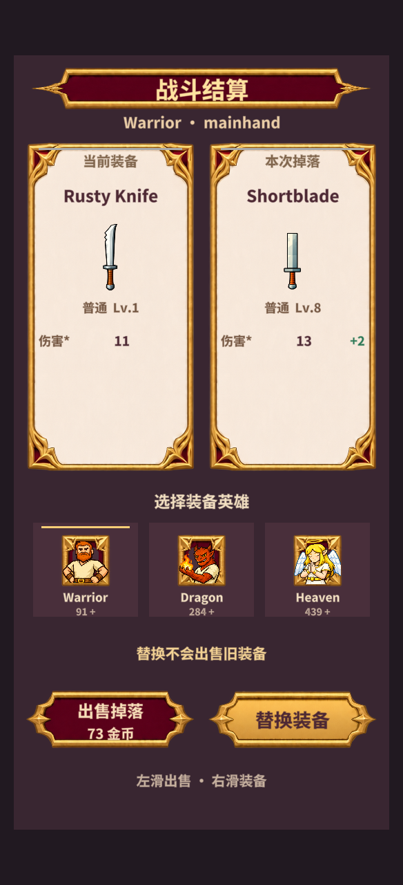
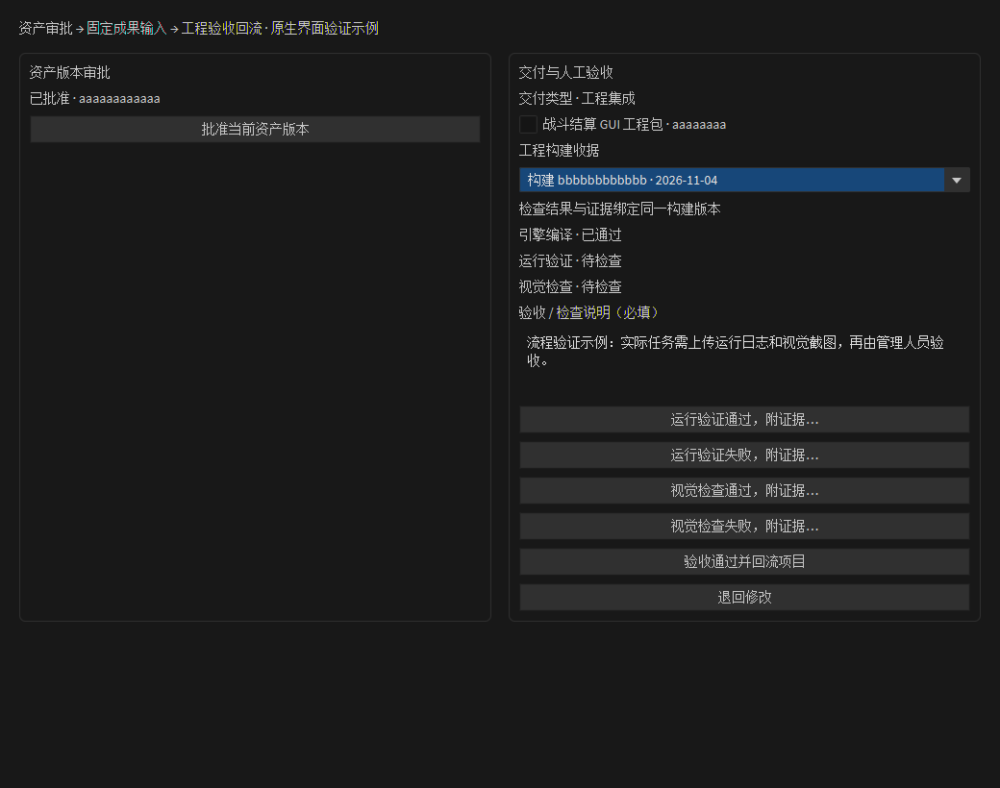

# AI Canvas 资产审批、成果准入与工程验收

更新：2026-11-05。当前本机已安装 Defold `1.14.1-patch.115`，正式 Companion `8769` 已更新至 `0.8.60`。文档、资产与工程交付使用同一项目台账，保留现有 v1 Canvas 文件格式。

## 操作流程

1. **管理人员审核 TaskCard**：在分配前选择交付类型：文档、资产包、工程集成。工程集成必须经过引擎编译、运行验证、视觉检查和人工验收。可以提前分配后置任务，前置关系在分配时冻结。
2. **Person 执行 Action**：任务仍只从负责人卡执行。执行前核对 Task 的前置验收，以及 Action 详情中选择的固定成果版本。普通 Action 可以接多个已批准 Assets 输入；连线保存具体版本，不自动切到新版。
3. **确认 Result**：选择方案时冻结文本和实际文件字节，记录人工批准，再将确认事项加入负责人队列。独立的后续 Action 继续执行。文件在外部被修改后，再确认会生成新的内容版本；原队列版本保持不变。
4. **批准 Assets**：资源生成完成后，在 Assets 详情点击“批准当前资产版本”。方案批准和实际资产包批准分别记录。美术拆分、文档归档或其他资源生成后，应批准产出的实际资产包，再交给后续职员。
5. **工程入库**：从待入库 Assets 创建资源入库 Action，批准资产后确认输入连线。负责人生成具体入库计划，查看差异检查报告并人工确认后，负责人先在候选工程编译，再核对基线并正式写入。批准后的素材被改动会阻止入库。
6. **工程检查**：在源 TaskCard 的“交付与人工验收”选择工程构建收据，分别记录运行与视觉检查结论，填写说明并附截图、日志等文件。证据可以点击查看，也可右键在文件管理器中定位。
7. **管理人员验收**：选择本任务已批准的交付版本，填写验收说明，点击“验收通过并回流项目”，或退回修改。通过后更新 Task、PM 阶段统计，并唤醒等待该成果的负责人队列；下次 PM 规划、职员执行会收到验收或退回记录。

## 版本与批准

`ai-workspace/project/work.json` 保存项目任务、职员执行、资产版本、批准和工程交付记录。旧 v1 台账缺少 `artifacts` 时按空列表读取，不改写旧 Canvas 格式。

资产文件复制到项目资料库的内容摘要目录，保存源路径、归档路径、文件名、大小和 SHA-256。版本同时覆盖文本、文件清单和 GUI/Atlas 等入口。批准绑定具体版本及清单摘要，同一版本重复点击批准不会重复登记。

后续编辑创建新版本，不改旧批准。执行时校验清单与归档文件，归档丢失、被修改或清单被改写时停止。Result 人工修改记录保留之前的候选内容；生成来源存在真实 job/thread/turn 时记录它们，旧数据缺失来源时标记 `legacy-unverified`。

这些是单机项目内的审计记录：操作来源记录为 `local-human`、`user-action`，并不代表引入了多用户认证服务。

## 成果依赖准入

| 情况 | 行为 |
| --- | --- |
| 前置 Task 只有工作 Canvas | 可以分配，执行时等待 |
| 前置任务只结束模型回合 | 显示待验收，依赖任务不执行 |
| 前置 Task 验收通过 | 锁定该次验收和选定资产版本 |
| Action 显式选择未批准或丢失版本 | 禁止提交模型请求或执行入库 |
| 排队中有阻塞项 | 阻塞项不占职员执行权，独立后续项仍按相对顺序执行 |
| 开始后批准了更新版本 | 当前执行与重试继续使用原输入，不自动换版 |
| 原作者停用或调整职能 | 已批准输入可继续复用；执行者自己的 Person 配置仍必须有效 |
| 复制了相同身份的工作 Canvas | 执行前核对 Task 与 Canvas 身份，冲突时停止 |

输入文件使用归档路径和摘要交给模型，Result 确认附件也使用固定副本。缺少关联的旧任务可从原 PM 分配和子 Canvas 身份补登记；不会据此补造完成回合、资产批准或验收结论。

执行消息会同时提供真实资产批准记录和本次锁定的前置验收记录。资料正文保留历史描述，例如核验时的“待确认”；职员应依据当前准入收据判断审批状态，不能把历史描述当作当前阻塞条件。

## 工程交付与验收

复用现有 GUI PNG、静态 Atlas、GUI 和已有引用的入库事务。新版源码先复制候选工程，在独立图和独立构建目录编译，通过后才进入正式写入与最终基线核对；写入阶段失败沿用事务回退与人工修改保护。验证不写入当前项目的 Play 构建输出。检查阶段、文件差异和边界见[资源发布检查](ai-publication-workflow.md)。

当 Assets 的 GUI 入口指向已有完整工程布局时，计划显式记录 `sourceGui`，冻结其来源摘要，并把模板引用重定向纳入同一事务。素材 manifest 中的拆图预览不再作为完整页面的替代来源。事务会区分自身引用更新和外部修改，仍要求写入后的精确摘要一致。

工程收据关联：

- 当前 Task、实际资产版本、入库事务和已批准计划；
- 正式文件摘要、编译依赖源文件摘要；
- 引擎版本、编译产物清单和构建编号；
- 同一构建上的运行、视觉检查结论与证据；
- 管理人员的验收或退回决定，以及当时的任务规格和执行集合。

验收前再次核对正式文件和依赖摘要。构建后的修改、错误资产归属、未批准版本、未完成/失败/待核对工作、缺少真实构建编号、缺少必需检查或证据都会阻止通过。入库计划和效果预览不能代替实际资产包交付。

运行和视觉结论必须结合证据登记，不会从编译成功自动推导。人工检查记录来源为 `local-human`；后台检查使用 `record-automated-check!`，来源为 `automation`，最终 Task 验收仍由管理人员决定。已有收据缺少构建编号时，需要生成新入库计划并重新编译。验收针对所选交付版本；没有连续监视工程所有文件的功能。

固定归档应使用引擎原生的非编辑目录设置保护。当前游戏的 `project.shared_editor_settings` 将 `/ai-workspace/artifacts/files` 和 `/ai-workspace/deliveries/files` 设为非编辑目录，避免 GUI 模板联动产生的派生保存数据写回旧版本。普通创作文件和正式工程资源仍可编辑；人工修改成果应建立新版本。

## 当前验证

Windows：161 项 AI Canvas 回归、1404 条断言通过，含实际 GUI、Atlas、纹理与材质编译，以及编译产物 → 工程收据 → GUI 绑定 → 版本批准 → Task 验收回流。测试夹具中的运行/视觉证据仅验证验收契约。

本次修改的入库、成果准入模块及相关测试 clj-kondo 零错误、零警告。`workspace.clj` 的既有 lint 警告保留。增量包按本机精确基线 `113 → 115` 校验、安装并重启，11 项安装验证通过；Companion 103 项 Rust 测试通过。

本次真实项目联调已完成：AI-PM 生成并经人工分配两项 Task；许如墨核验既有素材，人工批准固定包并验收交接；林序锁定该成果，生成并经人工确认入库计划；编辑器写入七个正式资源、更新三处引用、保留完整 51 节点 GUI，建立编译收据和原生 GUI 卡。

整项目编译产出 4230 项资源。`defold-background` 使用独立 QA 存档，在同一冻结构建验证替换、出售、空槽装备、多英雄四类场景，每次点击均结合关联业务回执与 UID 或金币/库存状态检查。584×1280 奖励画面与入库前固定基线的 747520 像素完全一致，差异为零。实际运行主 GUI、图集、字体和控制器的编译摘要与工程收据对应。

管理人员最终批准交付版本 `224e134f5ec2` 并验收通过后，原生 AI-PM 显示两项工作均已验收、两个阶段均已完成。此结论限定于已确认的素材复用范围；normal 素材、透明边缘及独立按钮状态图缺失等已知限制保留。五个 AI 子页签和常驻侧栏已恢复。

可追溯标识及摘要见[真实联调记录](ai-pm/production-validation-20261105.json)。以下为本轮后台原始 GPU 图：

## 后续扩展边界

本批完成资产版本审批、成果执行准入和现有 GUI 入库范围内的工程验收回流。通用脚本变更集、更多资源类型、候选工程预编译发布、多用户审核身份和 PM 重规划差异审核属于后续扩展，不能视为本批已实现。
