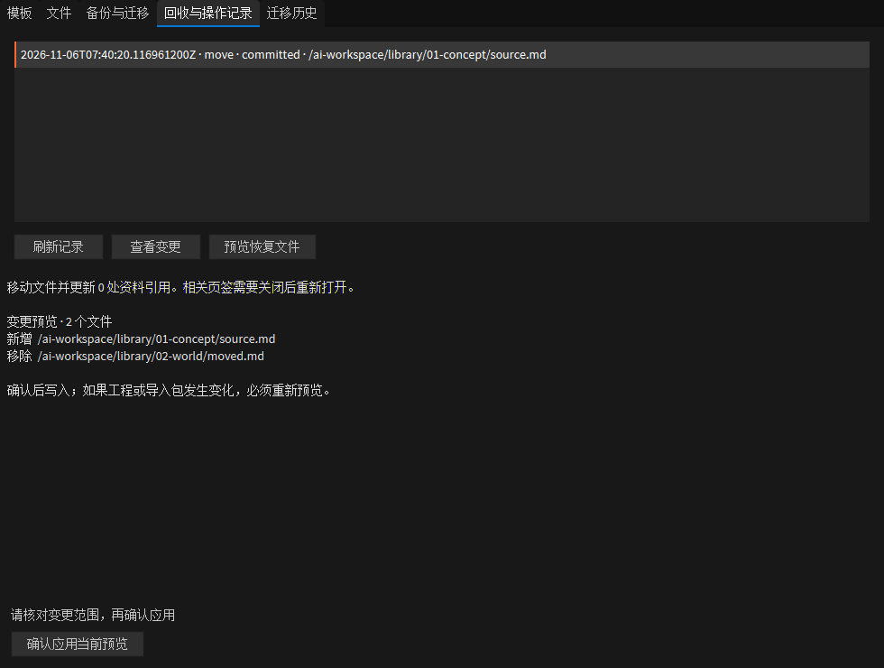
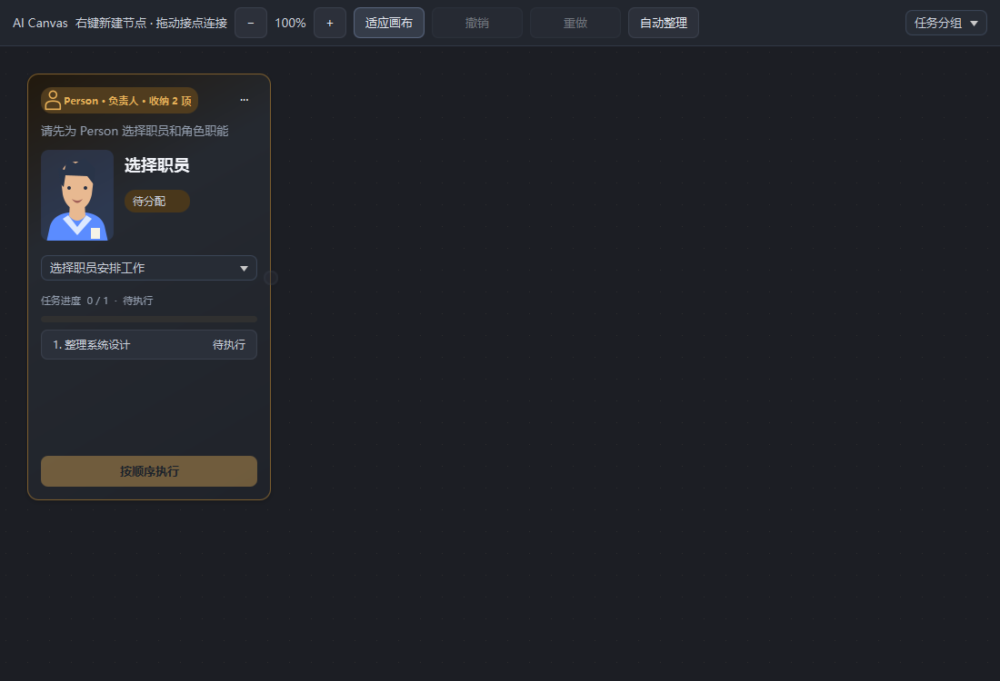

# 第 5 批：模板、文件治理与跨项目迁移

2026-11-06。保留现有工作台布局和引擎主题；不新增远端资料服务。

## 入口与使用顺序

在 **AI 工程左侧清单右键 → 模板与文件管理…** 打开原生管理窗口。选中文件后打开会带入文件路径。所有导入、移动、回收、恢复和迁移操作均先生成预览，再点击“确认应用当前预览”。预览本身不写入工程。

1. **模板**：导出职能定义、职员默认参数、Canvas 工作结构与资源规则。导入预览列出人员职责、交付要求、规则策略及文件新增/更新范围。已有职能定义冲突时新增独立定义，已有职员不被覆盖；资源规则默认保留本项目值，可显式选择采用模板规则。
2. **文件**：创作资料中的单个文件支持重命名、移动和移入回收站。移动会修复可识别的 Markdown 内联链接、引用式链接、HTML 图片/链接，以及结构化的项目绝对路径引用。未知引用或固定历史引用阻止移动；被引用文件不能移入回收站。
3. **备份与迁移**：备份保存到当前项目之外。可检查文件摘要及固定成果缺失，分别预览“恢复原项目”和“迁移到当前项目”。
4. **回收与操作记录**：查看每次受控写入涉及的文件，恢复移动/回收；中断操作可尝试恢复自身写入。目标已有人工修改时停止并保留双方内容。
5. **迁移历史**：旧资料通过独立清单打开，可右键定位文件；可单独校验历史文件完整性。内部台账不进入日常左侧菜单。

## 任务收纳

Canvas 工具栏的“任务分组”支持按负责人、阶段和任务列出分组，逐组收纳/展开，以及全部展开。收纳锚点显示隐藏项数，视口适应当前可见节点。原有“自动整理”继续按执行链布局。

收纳仅影响当前窗口的显示，不删除节点、断开固定结果连线或改变队列。收纳状态不写入工作文档；通过现有定位入口打开被隐藏节点时会展开并聚焦。

## 恢复与迁移的边界

| 操作 | 当前项目状态 | 旧资料与证据 |
| --- | --- | --- |
| 模板导入 | 新建目标项目专属职员、Canvas、卡片与阶段身份；Task 回到待人工确认 | 不复制 Result、Assets、GUI 产出、批准、分配状态或聊天绑定 |
| 原项目恢复 | 只接受同一项目根目录的备份；恢复台账；未执行完的队列暂停，需人工核对后继续 | 保留备份中的固定版本、审批和证据；备份之后新增的文件不删除 |
| 跨项目迁移 | 复用模板与创作资料，不接管新项目的活动台账、成功状态或工程入口 | 原工程文件和审批证据进入独立历史目录，并有本地完整性清单 |

旧 Canvas 在历史目录中改为 `.history.json`；旧 Editor Script 和 native extension manifest 改为 `.history.txt`，避免新项目扫描后意外执行。原始字节保留。迁移后的模板需要重新确认人员与接线、通过原有 Task 人工分配流程，并重新绑定本项目聊天。

备份排除 `.git`、构建缓存、`.internal`、聊天/Canvas 会话缓存、连接配置和以往迁移历史。**尚未归档的会话附件和临时预览不作为正式迁移成果**，应先收集成项目资料或固定成果。不会从 Companion 拉取缺失资料，也不会修改 Companion 服务。

## 文件事务与限制

- 应用前重新核对项目文件清单、所有目标的原内容和外部导入包摘要；预览后文件变化则要求重新预览。有执行中或待核对任务时阻止写入。
- 在项目台账锁内写入，每个原文件均有事务前副本；写入失败回退自己的修改，遇到外部改动保留冲突记录。重复执行同一个计划不会重复修改文件。
- 回收内容和事务副本保存在 `.internal/ai-governance`，不是永久删除。冻结成果、任务来源和验收历史不能通过普通文件移动绕过版本流程。
- 当前受控范围是创作资料中的**单个文件**，不提供整目录批量搬迁、任意工程文件重命名或聊天回合 Undo。历史/冻结路径冲突应新建资料版本，而非直接改写原记录。
- 当前扫描最多 30,000 个源文件；备份最多 256 MiB，单次写入最多 512 MiB，单个移动文件最多 128 MiB，引用文本扫描/管理 JSON 最大 16 MiB。超限时停止并说明原因，不做部分迁移。
- 本地管理不跟随符号链接、目录联接或路径跳转。已有不同内容的迁移目标不覆盖。应用完成后需重新打开受影响页签，旧页签的保存冲突保护继续生效。

## 验证

- 专项：`editor.ai-governance-test`，**13 项测试、77 条断言，全部通过**。覆盖引用修复、被引用删除拦截、真实文件系统写入失败回退、中断恢复冲突、模板身份隔离、重复导入、职能冲突、Task 清理、备份损坏、迁移历史校验及脚本保持非活动状态。
- 全 AI Canvas 源码回归：**206 项测试、1592 条断言，0 失败、1 环境错误**。唯一错误为已有 `library-path-boundary-test` 在本机创建符号链接时缺少 Windows 权限，未据此宣称全套通过。
- 所有本批 Clojure 修改均经 `lein cljfmt fix`，`clj-kondo` 0 错误、0 警告。
- 原生 UI：通过隔离 REPL 的 `cljfx.plorer` 实际点击文件预览、确认移动、查看记录、预览恢复及确认恢复；验证确认前源文件存在，恢复后原路径存在、移动目标消失。验证收纳后显示 1 张卡但源图仍为 3 个节点，定位结果后恢复显示 3 张卡。
- 未修改真实游戏工程，未启动职员模型任务，未重新进行游戏运行/工程验收。交付为源码及隔离原生 UI 验证，尚未打包安装新补丁。

主要实现：`ai_templates.clj`、`ai_file_ops.clj`、`ai_backup.clj`、`ai_governance_view.clj`、`ai_groups.clj`；接入现有 `ai_project_browser.clj` 和 `ai_canvas.clj`。
