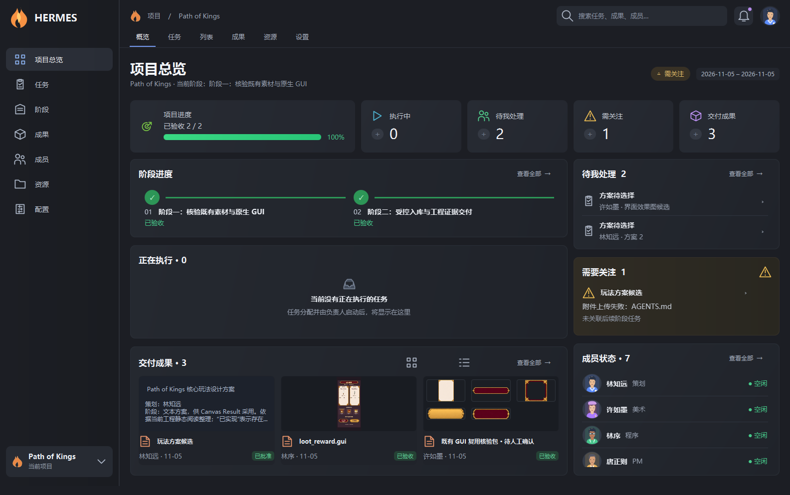

# AI Canvas HERMES 界面

以用户提供的 HERMES 工作台参考图为视觉基准，保留本地数据、任务队列、人工审批和成果版本的真实语义。

- 固定左侧功能导航；资源目录在“资源”项下缩进展开并独立滚动，移除底部重复的当前项目入口。顶部保留项目标识、全局搜索、待处理通知和成员入口。
- 总览包含五张统计卡。左列为阶段时间线、正在执行、交付成果；右列为待我处理、需要关注、成员状态。
- 总览没有外层滚动；六个内容区域分别滚动。窗口较矮时缩小卡片内边距、阶段标记和成果预览。
- 任务与列表入口显示完整任务列表。资源入口显示原来的常驻文件树；切换导航不会重建文件树或关闭文档。
- 返回按钮位于内容页标题左侧；阶段与状态筛选框统一为 36px 高度，避免文字裁切。各分区操作集中靠右，网格与列表按钮为 28px；导航采用矢量图标，“查看全部”使用占宽 10px 的窄折角，文字间距为 3px。
- 总览隐藏自己的文档标签条；打开 Canvas、职员、任务或文件后，恢复工作台内的标签条及原来的关闭范围。
- 职能卡、Canvas 节点、工具栏、详情、成果审阅、方案对比与 Markdown 阅读共用 AI 专属深色主题，不改变外部引擎菜单的主题。
- 统计和预览来自实际项目记录；不补造参考图中的阶段、日期、在线状态或美术缩略图。没有图片的文档显示正文摘要。

验证：原生 JavaFX 隔离窗口加载游戏项目的副本；通过 cljfx.plorer 点击任务、资源、总览和成员，检查返回、常驻树与标签。最新工作台、总览、Canvas 与 AI-PM 回归共 46 项测试、402 个断言通过。侧栏、标题和紧凑工具栏已在正式编辑器会话热加载，并检查网格／列表切换及实际控件尺寸；最后的窄箭头调整通过格式、静态检查和正式窗口尺寸检查。热加载仅对当前会话生效，这些后续界面修正尚未打入安装包。

