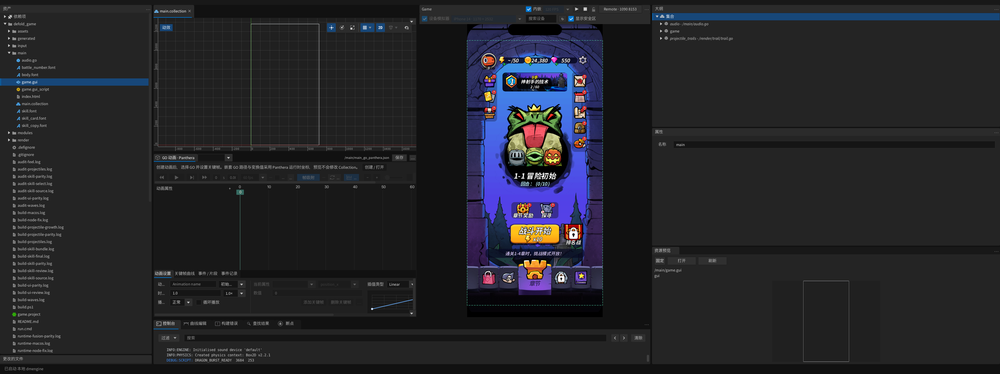

# 本机编译同步：patch.99

2026-10-25，完成当前编辑器源码的完整本地编译、98→99 增量安装，以及 Dragon Burst 项目专用 Spine 引擎的本地重新链接和同步。未上传项目，也未发布 GitHub。

- 编辑器：`/Applications/Defold.app`，版本 `1.14.1-patch.99`；168 项安装文件哈希及权限全部匹配，只保留一个 App。
- 配套引擎：使用当前引擎源码与项目已有的 Spine 4.9.4 原生静态库本地链接；没有重新编译第三方 Spine 静态库本身。
- 项目缓存和 `build/arm64-osx/dmengine` 均已更新。缓存键匹配当前编辑器和扩展资源，再次运行已验证使用新引擎。
- 新引擎 SHA-256：`df218b63ceea8cc7ca3ce9249bdbd4326bba68bf08f11796178011c9912c71de`。
- 保留原来可用的原生扩展服务 SDK 标识，避免本地构建默认的空标识影响后续扩展构建。

## 验证

编辑器 Game 和原生扩展路径回归共 21 tests、1076 assertions，0 failures、0 errors。真实项目脚本报告 `DRAGON_BURST_READY`；Game 在设备模拟器的 1170×2532 分辨率下输出画面，Ctrl+Shift+右键返回 `/main/game.guic`，资产栏实际选中 `/main/game.gui`。停止后再次启动，继续使用相同的新引擎。编辑器未禁用任何功能。

更新验证使用本地 HTTP 源，已完成下载、摘要校验、精确基线验证、安装与重启。构建记录、原引擎缓存备份和增量包保存在仓库 `tmp/compile-sync/`。

此项目若将来变更原生扩展依赖、SDK 或清空原生引擎缓存，需要重新链接相应配套引擎；普通 GUI／脚本修改不会因此回退到旧引擎。

