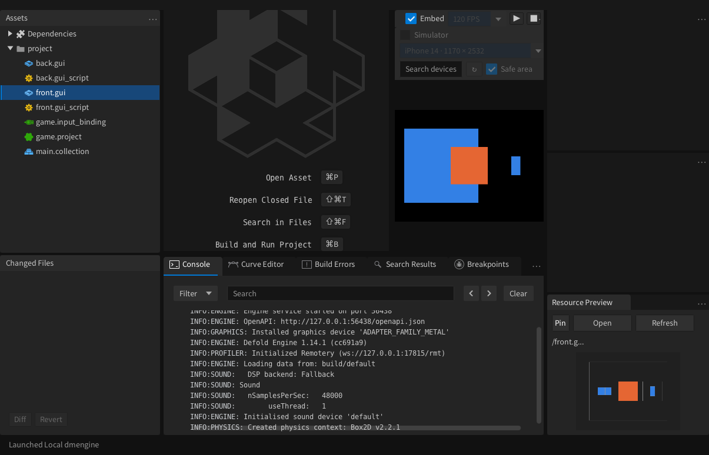
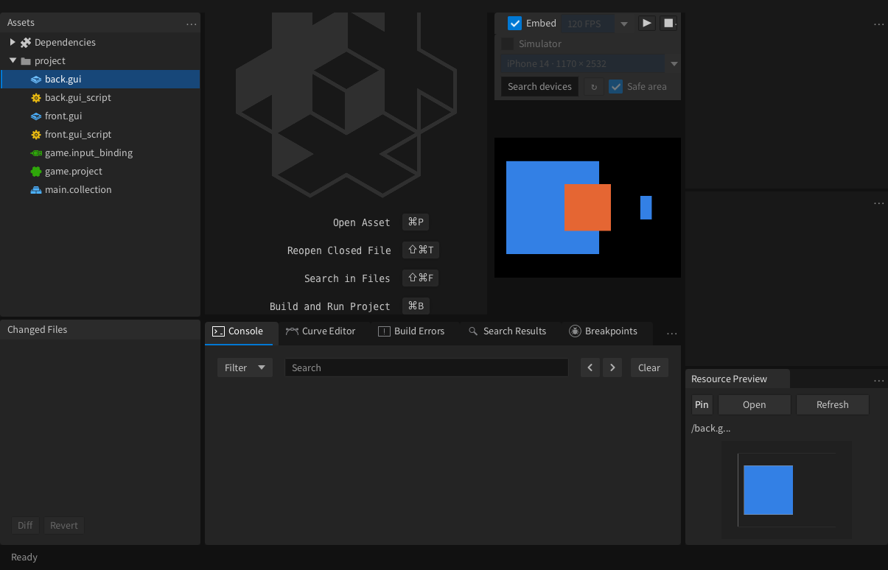

# Game 运行时 GUI 资源定位（patch.98）

在 macOS Game 画面中按住 **Control + Shift**，点击鼠标右键，资产树会展开并选中鼠标下方 GUI 对应的 `.gui` 源文件；资源预览也会随资产选择更新。这里使用 Control，不能用 Command 代替。

拾取来自游戏引擎本帧提交的 GUI 节点，不依赖当前编辑标签。多个 GUI 重叠时按 GUI 渲染顺序选择上层；禁用、完全透明节点和遮罩外部不命中。点击空白或画面黑边不会跳到其他文件。导航手势不会传成游戏右键，提前松开 Control/Shift 也不会泄漏按键。

## 范围

- 当前接入 macOS 内置调试引擎与共享帧 Game 视图。Windows 原生子窗口尚未接入。
- 原生扩展项目若仍使用旧引擎，需使用包含此次引擎改动的构建；仅更新桥接扩展不足以使旧引擎支持拾取。旧引擎会显示“不支持 GUI 资源定位”，不会回退到当前编辑资源。
- 命中几何沿用 `gui.pick_node` 节点边界语义，并检查父节点剪裁；不是逐纹理像素的 alpha 拾取。自定义 render 脚本的特殊投影、额外渲染目标和非矩形裁剪的精确像素覆盖不在此次验证范围内。
- 无持续场景遍历：只有收到导航请求时才检查 GUI 节点。请求、回应与输入／画面共享同一个文件锁，并有版本检查、序号和超时。

## 验证（macOS Apple Silicon，2026-10-25）

| 验证项 | 结果 |
| --- | --- |
| 编辑器 Game 回归测试 | 19 tests / 1066 assertions，0 failures / 0 errors |
| 引擎 `GuiTest.EditorGuiResourcePick` | 1 test / 14 assertions，通过；验证 GUI 源路径区别于脚本路径，隐藏、透明、请求状态重置 |
| 真实运行游戏 | 7 项通过：重叠前层、后层独占、禁用前层、透明前层、遮罩内、遮罩外、空白 |
| 实际组合键 | 前层选中 `/front.gui`，后层选中 `/back.gui`，空白保持原选择 |
| 提前释放修饰键 | 右键仍按住时游戏 buttons=0，释放右键后手势状态复位 |
| 普通右键对照 | 两个 GUI 脚本各收到一次普通右键；导航手势没有增加右键事件 |
| Clojure lint | 0 errors / 0 warnings |
| 安装版复测 | 从 `/Applications/Defold.app` 的 JAR 启动，无源码覆盖；点击运行构建项目，新内置引擎能力版本=1，组合键成功选中 `/front.gui` |
| 增量更新 | 本地 HTTP 更新源下载 97→98，SHA-256 / 精确基线校验，安装文件 168 项一致；未发布 GitHub |

截图与运行用例结果见 [验证目录](game-gui-pick-evidence/2026-10-25/)。

安装后原 Dragon Burst 项目已重新打开，界面未禁用；旧版安装备份完成校验后已清理，`/Applications` 仅保留 `Defold.app`。原项目含 Spine 原生扩展，本次没有上传或远程重建它的扩展引擎，因此该项目的旧缓存引擎不能使用新拾取能力；上述完整交互回归使用无原生扩展的双 GUI 测试项目。

后续更新：本机配套 Spine 引擎已在 patch.99 完成本地重链接和真实项目验证，见 [编译同步记录](compile-sync-99.md)。
