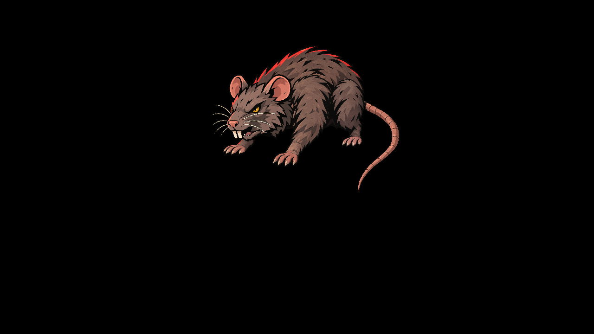

# tail_path_example 运行时性能基准与推荐值

日期：2026-11-14。设备：Apple M1 / 16 GiB / macOS 26.7.2。结论：**当前网格和骨骼规模的播放计算开销很小，先保留现有精度；优先处理导出兼容性和贴图预算。** 这是这台电脑、这个案例的基线，不是移动设备性能保证。

## 测的是什么

从运行中的 Defold 取得正在编辑的 `tail_path_example.skeleton` 快照，快照与磁盘内容一致。完成后再检查，文档和撤销历史均未变化。来源路径及哈希见 `metadata.json`。没有修改原案例、编辑器默认参数或运行时引擎。

- 当前实际骨架：20 根骨骼；其中尾巴 8 段，路径控制骨骼 2 个，1 条路径约束，Chain 模式、不拉伸。
- 尾巴：94 顶点、109 三角形、376 个权重影响，每顶点最多 4 个。
- 整角色还有其他网格、区域附件。以下耗时是**整角色**，不是只算尾巴。
- 原 `tail_path_demo` 长 2 秒，但没有变换、网格变形或约束关键帧。原样测试仍会求解骨架和路径，但不是正在摆动的动画。
- 因此另做临时 `benchmark_sway`：尾尖控制骨骼在 2 秒内按 ±12 / ±6 位移循环，网格和骨骼数量保持不变。官方 spine-core 4.2.120 检查 121 帧，尾巴顶点最大实际位移 11.62 世界单位，路径处于激活状态。

**兼容性前提：** 原导出标记为 `4.3.26`，游戏当前 Spine C 扩展为 `4.2`，直接加载会拒绝。测量使用独立的 `4.2.43` 标记副本；此案例在实际扩展中加载成功并完成播放。此处仅验证本案例所用字段，不代表任意 4.3 工程改版本号即可兼容。正式导出仍需要版本校验与对应格式导出，不能将本报告解读为原文件已经可以直接发布。

## 真实 Defold 后台播放

通过 `defold-background` 的 build_import、session_start、capture、logs_read 执行真实引擎和 GPU 渲染，使用本地游戏已编译的 dmengine（哈希在 metadata），1280×720、目标 60 Hz。所有实例共享同一套资源；按实例数缩小并排显示，**不是 64 个全屏角色叠加**。关闭骨骼 Game Object 的配置和开启配置均测试。

每项预热 120 帧、记录 240 帧，完整执行两轮；每轮起止包含空场景。CPU 数字为 `os.clock()` 得到的进程 CPU 时间 / 帧，包含进程线程工作，不是 GPU 毫秒，也不等于帧关键路径耗时。

| 同屏角色数 | 骨骼 GO | 平均进程 CPU / 帧 | 相对空场景约增加 | 两轮 CPU 范围 |
|---:|:---:|---:|---:|---:|
| 0 | 关 | 1.207 ms | — | 1.165–1.256 ms |
| 1 | 关 | 1.302 ms | 0.095 ms | 1.300–1.303 ms |
| 16 | 关 | 1.671 ms | 0.464 ms | 1.657–1.685 ms |
| 64 | 关 | 2.373 ms | 1.167 ms | 2.315–2.431 ms |
| 1 | 开 | 1.373 ms | 0.167 ms | 1.351–1.396 ms |
| 64 | 开 | 2.411 ms | 1.204 ms | 2.273–2.550 ms |

开关骨骼 GO 的差异小于本轮波动，不能据此声称某个固定提升百分比。没有挂点或逐骨骼 GO 访问需求时，推荐关闭；需要时保留并复测。

平均帧间隔约 16.66–16.70 ms。空场景的 P95 帧间隔也约 21.88 ms，64 实例约 21.69 ms，说明后台调度/节拍噪声已经存在，**不能据此宣称稳定 60 FPS**。这次未单独测 GPU 执行时间、实际游戏逻辑叠加开销或手机性能。原始日志见 `background-driver.log`，逐项采样见 `engine-results.json`。



此图是单角色阶段原始运行时帧，未经重绘或裁剪；build/session/frame/hash 见 `background-captures.json` 第一项。第二项是结束时空场景记录。

## 原生 Spine C 微基准

直接编译游戏扩展中的 Spine C 源码，Apple clang 21、`-O3 -DNDEBUG`。与游戏组件一致，显式激活默认皮肤，确保皮肤关联的尾骨及路径参与计算。共享 SkeletonData，每实例独立 Skeleton 和 AnimationState。测量动画更新、路径/骨骼世界变换及所有可见 region/mesh 世界顶点，不含 Defold 顶点打包、材质、Draw Call 和 GPU。

每项 3 次独立进程，预热 600 帧，测 200 批 × 30 帧。下表取三次结果的中位数；P50/P95 是 **30 帧批均值的分位数**，不是单帧卡顿分位数。微基准用单线程单调时钟计时，调度扰动仍可能影响结果。

| 连续摆尾实例数 | 求解＋顶点 P50 | P95 | Spine 实例分配量（合计） |
|---:|---:|---:|---:|
| 1 | 0.00142 ms | 0.00151 ms | 8 KiB |
| 16 | 0.02392 ms | 0.04405 ms | 126 KiB |
| 64 | 0.09982 ms | 0.12866 ms | 506 KiB |
| 128 | 0.21551 ms | 0.33037 ms | 1011 KiB |
| 256 | 0.40810 ms | 0.49299 ms | 2022 KiB |

单例平均求解约 0.00089 ms，顶点变换约 0.00058 ms。原样无关键帧的 64 实例 P50 为 0.09983 ms，和连续摆尾接近，符合每帧都要求解路径及顶点的实际流程。所有配置的测量期内 Spine 分配器新增分配均为 0。

分配量来自 Spine 分配器钩子，是请求字节数，不是 RSS；不含系统分配器开销、测试顶点缓冲和引擎资源。共享 atlas / skeleton / reader 约 34,501 字节，不随实例复制。实际游戏进程 RSS 约 59–75 MiB，受系统回收影响，不能直接相减推算每实例或 GPU 内存。

## 配置对照与推荐

以下均为 64 实例原生 P50。布骨重建方案同时改变路径、绑定和部分顶点数量，是整套方案对照，不能归因于单一参数。

| 测试配置（尾骨 / 控制骨骼 / 尾巴顶点） | 耗时 |
|---|---:|
| 当前 8 / 2 / 94，4 权重 | 0.09982 ms |
| 重建 4 / 2 / 46，4 权重 | 0.06151 ms |
| 重建 6 / 3 / 50，4 权重 | 0.07501 ms |
| 重建 8 / 3 / 54，4 权重 | 0.08901 ms |
| 重建 8 / 3 / 94，4 权重 | 0.09969 ms |
| 重建 8 / 3 / 157，4 权重 | 0.12075 ms |
| 重建 12 / 3 / 102，4 权重 | 0.12991 ms |
| 重建 16 / 4 / 110，4 权重 | 0.15540 ms |
| 重建 32 / 8 / 142，4 权重 | 0.27946 ms |

固定当前骨架和 94 顶点，仅保留最大的 2 个权重并归一化：0.08556 ms，约减少 14% 原生求解＋顶点时间；3 权重为 0.09254 ms。不是整帧提速 14%。逐帧比较中，2 权重最大误差 1.738、RMS 0.358 世界单位；3 权重最大 0.895、RMS 0.198。像素偏差还要乘角色显示比例。未重新优化降权重后的绑定，因此这是简单裁剪的结果，不能等同于专门制作的低模。

推荐值已写入 `recommended-presets.json`，**只作为制作规范，不覆盖当前资产或编辑器默认设置**：

| 用途 | 尾骨 | 控制骨骼 | 尾巴顶点目标 | 每点权重 | 拉伸 |
|---|---:|---:|---:|---:|:---:|
| 当前角色 / 主要角色 | 8 | 2；需要中段控制时 3 | 64–100 | 4 | 关 |
| 小尺寸 / 群体角色候选 | 6 | 3 | 40–60 | 2，需检查形变 | 关 |

当前 94 顶点已经落在主要角色建议范围，不建议无条件重布网。群体档的“6 骨骼＋2 权重”组合是制作建议，尚未作为一个组合做完整游戏和画质验证；本次分别测了 6 骨骼方案与降低权重，不能把两项提速相加。

自动描绘起始参数可用整数：细节 20、凹度 50、精度 50、统一 30%、Alpha 阈值 8、扩边 0；较轻网格尝试细节 8。**最终以实际顶点数与轮廓质量为准**：在此素材上细节 2 / 8 / 20 / 40 的重建结果为 69 / 54 / 94 / 157 点，当前算法不是严格单调，不能把滑杆值当作顶点上限。

超过 12 段尾骨、4 个控制骨骼或 128 个尾巴顶点时，建议触发人工检查和复测，而非强制截断。全角色骨骼数及其他附件仍需一起计算。

## 贴图预算与回归门槛

本次编译的整角色 atlas 为 4096×2048 RGBA8，基础像素数据 **32 MiB**，多个实例共享，不是每实例 32 MiB。`texturec` 大小 33,554,481 字节，其中头部 49 字节。本例纹理资源比 Spine 实例数据大得多。若画面尺寸允许，2048×1024 的同格式数据理论上为 8 MiB；这只是容量推算，本次未做降分辨率画质验收，也没有测平台纹理压缩收益。

同机、同版本、同素材复测的初始提醒值：64 实例原生 P50 > 0.15 ms；完整引擎平均进程 CPU > 3.0 ms/帧；扣空场景后 > 1.5 ms/帧；或稳定中位数比本基线回退 > 20%。这些是建议警戒值，不是硬 CI 门槛。触发后先排除温度、后台负载和资源变化，再完整重跑至少 3 次原生矩阵、2 轮引擎测试。尚未推导手机上的同屏上限。

## 复测

本目录保存快照、全部 JSON 测试配置、原始结果、原生基准、后台驱动与纯源码测试项目，没有保留二进制安装包。

1. 把本目录复制到临时目录，避免覆盖已归档结果。
2. 从游戏的 `defold-spine` 编译原生基准，再运行 `run_native.py`。它只用于这里已知尺寸、合法的固定测试输入。

```sh
clang -O3 -DNDEBUG -I "$SPINE_EXTENSION/include" "$BENCH/native_bench.c" "$SPINE_EXTENSION"/commonsrc/spine/*.c -o "$BENCH/native_bench"
python3.12 "$BENCH/run_native.py" "$BENCH"
node "$BENCH/quality.mjs" "$SPINE_CORE/dist/index.js" "$BENCH"
```

`SPINE_EXTENSION` 指向实际游戏扩展，`SPINE_CORE` 使用官方 4.2.120，`BENCH` 为临时副本。不能把历史结果与换过版本的新结果混记。`metadata.json` 保存本次全部 Spine C 源文件及头文件哈希。

3. 完整引擎复测：把 `project-source` 复制为隔离工作目录中的 `project`；将原项目 `docs/source/spine_smart_mesh_validation/imported_images/*.png` 复制到 `project/images/`；复制游戏 `defold-spine/assets` 与 `defold-spine/plugins` 到相同相对位置，并把 plugins 放到 `project/build/plugins/defold-spine/plugins` 供 Bob 发现。不要复制 ext.manifest，使用现有相同引擎。按 `scripts/automation/README.md` 在工作目录 `automation` 构建 sidecar，指定当前 Defold.app 和已编译引擎。使用 Bob 对隔离项目执行资源 build；随后 `python3.12 run_background.py DEFOLD_REPOSITORY WORK_DIRECTORY`。驱动调用真正的 defold-background MCP，不操作桌面或原项目，等待 BENCH_DONE 后停止后台会话。
4. 若实际动画、材质、图集、蒙皮、约束、实例可见面积发生变化，需要重建测试项目并重新记录资源哈希。本次报告不是这些改变之后的性能承诺。

参考：Defold 官方 [性能分析](https://defold.com/manuals/profiling/) 与 [Profiler API](https://defold.com/ref/profiler-lua/)。本报告所有数值以本地实测记录为准。
