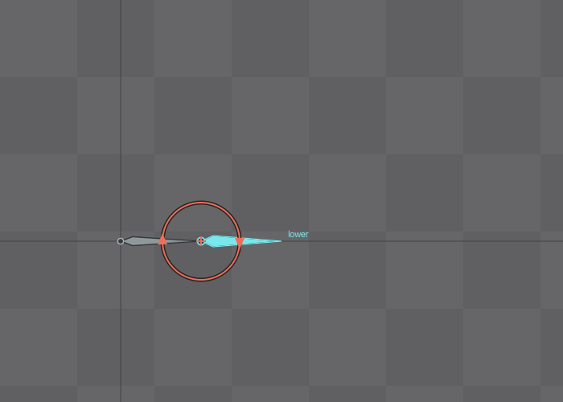

# 骨骼旋转操作改进（2026-11-12）

旋转模式新增骨骼旋转环：固定屏幕半径 48 px、命中容差 10 px、双向箭头及悬停高亮，短骨骼和零长度骨骼均可操作。命中旋转环优先保持当前选择，避免误选重叠骨骼或清空选择。原有网格顶点编辑、骨骼选择、Shift 15° 吸附和多选变换保持原逻辑。

使用：选中骨骼，在画布有焦点时按 C 切换旋转工具，拖动红色圆环；按住 Shift 吸附至 15°。旋转形成一次可撤销操作。父子同时选中时子节点不会重复旋转。

验证：91 项测试、826 个断言，零失败、零错误。通过 cljfx.plorer 分发鼠标和键盘事件，覆盖设置/动画模式、0/5 长度骨骼、0.5/1/2 倍缩放、重叠选择、撤销/重做、Shift 吸附和父子多选。实际 JavaFX Canvas 绘制截图已检查。clj-kondo 零错误，遗留警告未在本次修改行新增。

代码已会话热加载，当前文档保持不变，无禁用处理器或停止计时器。保存后重新打开编辑标签页使用新逻辑；未打包安装，重启应用不保留热加载。仅编辑器 view 与对应交互测试发生本次修改，运行时引擎未改。

证据见 skeletal-animation-evidence/2026-11-12/rotation-handle/。
