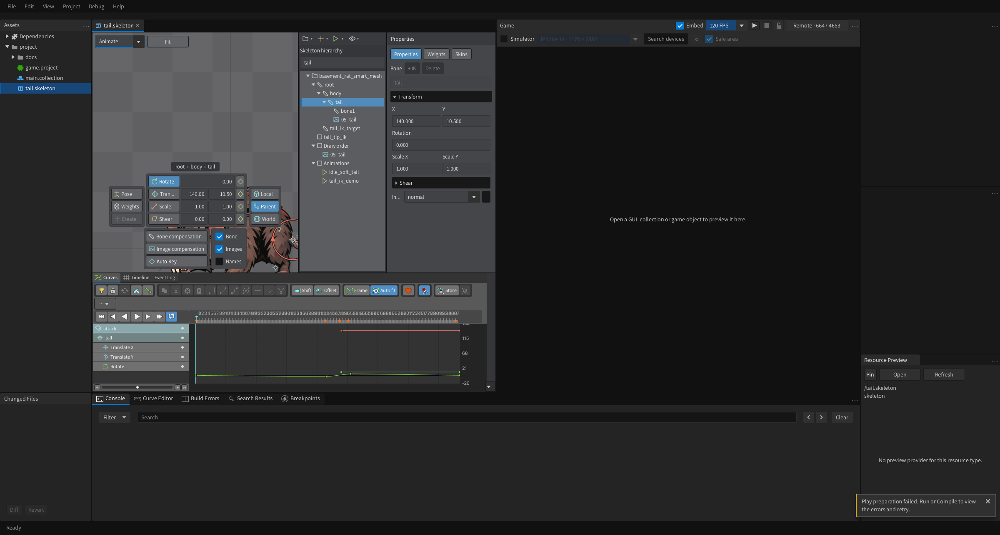
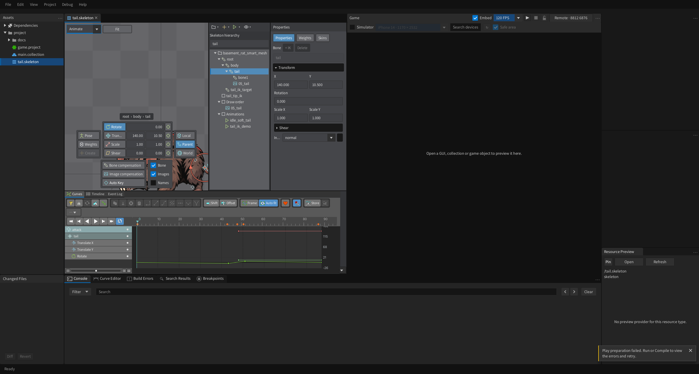

# Spine 操作与界面对照（2026-11-13）

本轮依据 Spine 官方 Tools、Meshes 说明、用户提供的参考截图，以及本机源码编译后的独立 Defold 窗口核查。不是完整 Spine 编辑器的逐像素一致性验收。当前应用 REPL 连接被拒绝，因此没有热加载或安装，用户工程未作为测试工作目录。

## 本轮已修复

| 差异 | 修复后的行为 | 验证 |
| --- | --- | --- |
| 骨骼选中后，在空白处拖动会进入框选 | 旋转、移动、缩放、倾斜工具可从空白处调整当前骨骼；Cmd 框选和中键框选保留 | 设置/动画模式、四种变换、选择保持和撤销；完整窗口验证 tail 旋转 |
| 右键单击没有工具切换 | 普通工具与上一个工具互换；设置模式的网格工具按修改→创建→删除循环 | 单击、拖动、同帧移出再返回、按钮选中状态；拖动画布不切工具 |
| 时间轴帧号重叠 | 根据可用宽度和数字位数选择 1/2/5 系列间隔 | 窄/宽窗口、长时间范围、正负时间偏移；完整窗口截图 |
| 工具快捷键不易发现 | 工具按钮悬停提示显示 C/V/X/Z/G/B/N | 与当前键盘映射一致 |

骨骼旋转环及 Shift 15° 吸附保留。运行时引擎未改。

## 仍有差异，未在本轮宣称补齐

| 优先级 | 项目 | 当前证据及下一步 |
| --- | --- | --- |
| 高 | 窄画布的底部操作面板 | 完整窗口截图中面板分成多行，遮挡模型；部分英文标签截断。应按画布可用宽度设计紧凑布局/折叠，避免仅缩小字号。外层 Game 停靠窗还占据一部分空间，这属于用户布局，未擅自改动。 |
| 高 | 连续旋转的角度累计 | drag-bone 仍把起终点差值归一化到半圈范围，缺少跨圈累计。需要增加经过 ±180° 和多圈的拖动测试，分别处理局部动画角度与世界方向。当前数字输入支持相对值，不等于连续鼠标拖动已完整对齐。 |
| 中 | 层级树图标与对象层次 | 本轮 tail 截图仍使用 Defold 风格图标，骨骼下的图片行没有完整复刻参考图的插槽/附件双层表现。需要结合蒙皮、链接附件选择语义调整，不能只换图标。 |
| 中 | 数值编辑手感 | 当前支持输入相对值和聚焦后滚轮调整；尚未提供 Spine 式数字上下拖动。应与一次撤销、动画自动打帧一起处理。 |
| 中 | 工具栏/属性样式 | 动画栏已有参考图标，但骨骼工具、属性和开关仍混用 Defold 控件；尚未逐尺寸对齐。属性在层级右侧是用户之前要求的布局，保留。 |

空格播放/暂停、左右键逐帧保留用户先前指定的行为；不为追求默认快捷键一致而改回 Spine 的清选/变换按键。官方文档中网格描绘会清除权重与变形帧，而本项目要求尽量保留，它也是有意保留的差异。

## 验证证据

- 源码与编译版均为 99 tests / 1007 assertions，零失败、零错误。
- 后台独立编辑器真实交互 35 步通过，包含旋转、撤销、工具切换、平移、模式切换和播放暂停；退出码 0，无原生崩溃。
- clj-kondo 零错误、修改行零新增警告；git diff --check 通过。
- 本轮修改输入和刻度显示，没有改姿态求值或导出；本轮未重跑 Spine 官方逐帧对照，不把之前的对照结果记为本轮执行。
- 验证包只编译 editor.skeletal-animation-toolbar 和 editor.skeletal-animation-view；不是安装包，未改变已安装应用。

[证据目录](skeletal-animation-evidence/2026-11-13/operation-ui-parity/)

刻度修复前：

刻度修复后：

## 官方依据

- [Spine Tools：选择、变换、右键工具切换、数字编辑](https://esotericsoftware.com/spine-tools)
- [Spine Meshes：网格编辑工具和描绘](https://esotericsoftware.com/spine-meshes)
- [Spine Keys：局部旋转与世界方向](https://esotericsoftware.com/spine-keys)
